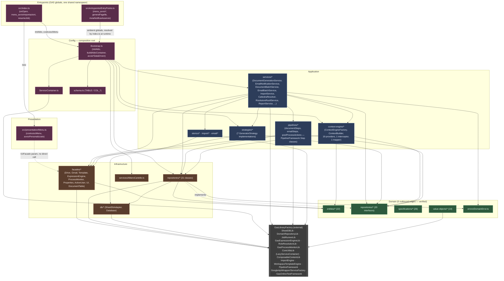

# ALDO (SGSA) — Architectural Inventory of `src/`

This document is a file-by-file architectural inventory of ALDO's own application code — the `src/` tree of this repository, plus the root-level build/config tooling that shapes it. It excludes `GasLibraryFactory/` internals (referenced only as an external dependency ALDO calls into — see its own `CLAUDE.md`/`DOCS_LIBS`) and excludes all test code (`test/`, `*.test.ts`, `__mocks__`, fixtures).

**Method**: built from the `aldo-onlinetests-debug` codebase-memory-mcp graph (this project's `home-giulio-Desktop-ALDO-implementing` index was found stale/degenerate — 75 nodes — at the start of this task; `aldo-onlinetests-debug`, indexed against the same `HEAD` commit `203ea16`, was healthy: 3267 nodes/10893 edges, 1820 nodes/6331 edges scoped to `src/`). Folder/file inventory, layer boundaries (`get_architecture`), symbol tables (`search_graph`/`query_graph`), and cross-file wiring (`trace_path`) were pulled from the graph; `Read`/`Grep` filled gaps (library-usage tagging, a few files' full bodies) the graph's structural view doesn't carry.

**Verified layering health** (`get_architecture(path="src")`, boundary edge counts): `infrastructure→domain` (59 calls), `application→infrastructure` (52), `application→domain` (39), `config→application` (20), `config→infrastructure` (19), `config→domain` (3), `onlinetests→domain`/`→infrastructure` (8/7), `src→config`/`→infrastructure` (5/3, from `index.ts`). **Zero outbound edges from `domain`** — the domain package's 388 nodes have fan-in only, confirming it is genuinely GAS/infrastructure-agnostic. No back-edges (`domain→application`, `domain→infrastructure`, `infrastructure→application`, anything `→presentation`) were found — the dependency direction is clean, matching CLAUDE.md's Clean Architecture mandate. A grep-based bypass check for native GAS globals (`SpreadsheetApp`, `DriveApp`, `DocumentApp`, `GmailApp`, `MailApp`, `PropertiesService`, `CacheService`, `UrlFetchApp`, `Utilities`, `Session`, `ScriptApp`, `LockService`) outside facades found no leaks: every apparent hit outside `infrastructure/facades/*` and the `onlinetests` harness was a comment or a `ServiceFactory.getXService()` call (GoogleApiWrapper's own indirection), never the raw global.

---

## `src/domain/`

The domain core: entities, value objects, specifications, repository interfaces, and the one domain error hierarchy. Confirmed GAS/library-agnostic by the graph (0 outbound call/import edges leaving this package). Every entity mirrors one physical table from `SPECS_ALDO/01_SCHEMA_DATABASE.md`.

### `src/domain/entities/`

Plain data-holding classes (each pairs a `*Data` interface with a class wrapping it), one per DB table, extending the shared `AldoEntity` base.

- **`AldoEntity.ts`** — Abstract base class for every domain entity; supplies identity-based equality. *Domain.* Extended by all 21 entity classes below; no outbound dependencies except a `DomainRepositoryLib` structural type.
- **`Alunno.ts`** (`Alunno`, `AlunnoData`) — Student entity: active/inactive status, BES flag, contact data, tutor reference, historical links. *Domain.* Consumed heavily by `AlunnoRepository`, `AlunnoProvider`, and most `application/context-engine` providers; referenced by `IAlunnoRepository`.
- **`Carenza.ts`** (`Carenza`, `CarenzaData`) — Academic-shortfall (insufficiency) record for a student in a subject. *Domain.* Read by `CarenzaRepository`, `CarenzeProvider`, `CarenzaFocusProvider`, `CarenzaSpecs`.
- **`Classe.ts`** (`Classe`, `ClasseData`) — School-class entity, with support for composite/articulated classes and their `Indirizzo`. *Domain.* Central aggregate root — consumed by nearly every repository, provider, and strategy that resolves a class-level context.
- **`ConfigurazioneDocumento.ts`** (`ConfigurazioneDocumento`, `ConfigurazioneDocumentoData`) — Document-generation rule row, mapped onto `CONF_DOC`. *Domain.* Read by `ConfigurazioneDocumentoRepository` and consumed by `DocumentGenerationService`/`documentSteps.ts` to select templates and generator strategy.
- **`ConfigurazioneEmail.ts`** (`ConfigurazioneEmail`, `ConfigurazioneEmailData`) — Email-composition rule row, mapped onto `CONF_MAIL`. *Domain.* Read by `ConfigurazioneEmailRepository`, drives `EmailNotificationService`/`emailSteps.ts`.
- **`ConfigurazioneImport.ts`** (`ConfigurazioneImport`, `ConfigurazioneImportData`) — ETL/import mapping rule, mapped onto `CONF_IMP`. *Domain.* Read by `ConfigurazioneImportRepository`, consumed by `ImportService`/`ImportRecipeMapper`.
- **`ConsiglioDiClasse.ts`** (`ConsiglioDiClasse`, `Cattedra`) — Aggregate of the class council (coordinator, secretary, one teacher per subject/`Cattedra`). *Domain.* Built by `IClasseRepository.getConsiglioDiClasse` and consumed by `CdcAssembler`/`ConsiglioClasseProvider`.
- **`Dipartimento.ts`** (`Dipartimento`, `DipartimentoData`) — Academic department entity, with associated subjects and coordinator. *Domain.* Read by `DipartimentoRepository`; queried by `MateriePerDipartimentoSpec`/`DocentiPerDipartimentoSpec`.
- **`Docente.ts`** (`Docente`, `DocenteData`) — Teacher entity: contact data and special-role associations. *Domain.* Central to role resolution (`CattedraResolver`, `RisolutoreRuoliService`) and most CDU providers.
- **`Indirizzo.ts`** (`Indirizzo`, `IndirizzoData`) — Course-of-study/curriculum entity. *Domain.* Read by `IndirizzoRepository`; filtered by `IndirizziPerTipoSpec`.
- **`LogCartella.ts`** (`LogCartella`, `LogCartellaData`) — Record of a Drive folder created for tracking, mapped onto `LOG_FOLD`. *Domain.* Written by `AlberoCartelle` via `LogCartellaRepository`.
- **`LogDocumento.ts`** (`LogDocumento`, `LogDocumentoData`) — Record of a generated document and its approval state, mapped onto `LOG_DOCS`. *Domain.* Written by `documentSteps.ts`'s `RegisterDocumentStep`; read by `DocumentiProvider` and the `PianiPers*`/`Documenti*` providers.
- **`LogEmail.ts`** (`LogEmail`, `LogEmailData`) — Send/delivery-state record for every email, mapped onto `LOG_MAIL`. *Domain.* Written by `emailSteps.ts`'s `LogEmailStep`; read by `EmailRetryService`.
- **`MasterConfig.ts`** (`MasterConfig`, `MasterConfigData`) — Global yearly configuration (principal, root folder id, etc.), mapped onto `MASTER`. *Domain.* Read by `MasterSheetRepository`/`IMasterSheetRepository`; central to `Bootstrap.ts`'s `BootstrapDeps.master`.
- **`Materia.ts`** (`Materia`, `MateriaData`) — Single subject entity with exam-related options. *Domain.* Read by `MateriaRepository` (cached); used across specs (`MaterieEsameSpec`, `MateriePerDipartimentoSpec`).
- **`MovimentoAlunno.ts`** (`MovimentoAlunno`, `MovimentoAlunnoData`) — Student transfer/withdrawal/class-change record, mapped onto `MOV_ALUNNI`. *Domain.* Read by `MovimentoAlunnoRepository`; filtered by `MovimentoAlunnoSpecs`.
- **`OreASL.ts`** (`OreASL`, `OreASLData`) — Work-experience (ASL/PCTO) hours record, mapped onto `ASL`. *Domain.* Read/written by `OreASLRepository`; aggregated by `IAlunnoRepository.getOreASLTotali`.
- **`Piano.ts`** (`Piano`, `PianoData`) — Personalized education plan (PDP/PEI), mapped onto `PIANI`. *Domain.* Read by `PianoRepository`; consumed by `PianiProvider` and the `PianiPers*` providers.
- **`Progetto.ts`** (`Progetto`, `ProgettoData`) — Project/PCTO activity entity, mapped onto `PROGETTI`. *Domain.* Read by `ProgettoRepository`; filtered by `ProgettoSpecs`.
- **`RuoloSpeciale.ts`** (`RuoloSpeciale`, `RuoloSpecialeData`) — Special institutional role (digital-innovation lead, orientation tutor, etc.), mapped onto `RUOLI`. *Domain.* Read (cached) by `RuoloSpecialeRepository`; resolved by `RisolutoreRuoliService`.
- **`Supplenza.ts`** (`Supplenza`, `SupplenzaData`) — Temporary teacher substitution, mapped onto `SUPPLENZE`. *Domain.* Priority-1 source in the role-resolution hierarchy; read by `SupplenzaRepository`/`CattedraResolver`/`SupplentiSubstitutionLookup`.
- **`VariazioneCattedra.ts`** (`VariazioneCattedra`, `VariazioneCattedraData`) — Permanent teaching-assignment change effective from a given date, mapped onto `VARIAZIONI_CATTEDRA`. *Domain.* Priority-2 source in role resolution; read by `VariazioneCattedraRepository`/`CattedraResolver`.

### `src/domain/errors/`

- **`DomainError.ts`** (`DomainError`, `ConfigurationError`, `EntityNotFoundError`, `MateriaNotFoundError`, `PipelineError`, `ValidationError`) — The full standardized domain-error hierarchy. *Domain.* Thrown throughout `application/*` and `infrastructure/repositories/*`; caught at the entrypoint boundary (`EntryPoints.ts`'s `resumeJob`, `Menu.ts`'s `avvioPersonalizzato`) and by `ServiceContainer.get` on an unregistered lookup.

### `src/domain/repositories/`

19 files declaring 20 interfaces — the abstraction every `infrastructure/repositories/*.ts` class implements. Kept free of infrastructure imports even where they mirror an infrastructure port structurally (see `IExpressionEnginePort` below).

- **`IAlunnoRepository.ts`** — `findById`/`findAttivi` plus aggregate navigation: `getCarenze`, `getPiani`, `getOreASLTotali`.
- **`ICarenzaRepository.ts`** — `findAll`/`findByAlunno`/`findByClasse`/`findNonNotificate`, plus per-subject shortfall map read/write (`getCarenzePerMateria`, `setCarenzaMateria`).
- **`IClasseRepository.ts`** — By far the largest (41 lines): base lookups, `getConsiglioDiClasse`, the cattedra/role matrix (`getDocentiPerMateria`, `getAllDocentiCDC`, `getDocentiIRC/ALT`, `getCoordinatori`, `getDocentiRuolo`), articulated-class support (`isArticolata`, `getGruppoArticolazione`, `orderedPartners`, `getMaterieArticolazione`), and per-teacher subject lookups. Also exports the `RepoRow` type alias.
- **`IConfigurazioneDocumentoRepository.ts`** — `shouldGenerate` (evaluates `CONF_DOC.CONDIZIONE` via the injected expression-engine port) and `resolveTemplateId` (resolves `MODELLI`, including the conditional-array form). Also declares the local `IExpressionEnginePort` interface — a structural mirror of infrastructure's `IExpressionEngine` kept local specifically so this file has no infrastructure import, per CLAUDE.md's domain-purity rule; TypeScript structural typing makes the two interchangeable at call sites.
- **`IConfigurazioneEmailRepository.ts`** — `findById` only (thin wrapper over the library's generic `Repository<T>` base).
- **`IConfigurazioneImportRepository.ts`** — `findById` plus `findAttivi` (enabled import jobs).
- **`IDipartimentoRepository.ts`** — `findByMateria` (department owning a given subject).
- **`IDocenteRepository.ts`** — `findById`/`findAll`.
- **`ILogCartellaRepository.ts`** — `findAll`/`findByClasse`.
- **`ILogDocumentoRepository.ts`** — `findAll`/`findByClasse`/`findByUtente`.
- **`ILogEmailRepository.ts`** — `findFailed`, `marcaSuccesso` (flip to SUCCESS via composite-key write), `registraInvio` (append a send record).
- **`IMasterSheetRepository.ts`** — `findConfigAnnoCorrente` (current year, top row) / `findAnniStorici` (historical rows).
- **`IMateriaRepository.ts`** — Cached lookups (`findAllCached`, `findByIdCached`, `findAllSigle`) plus base `findById`.
- **`IMovimentoAlunnoRepository.ts`** — `findByAlunno`, most-recent-first.
- **`IOreASLRepository.ts`** — `getOrCreate` (existing or fresh zero-hours record), `getTotaleOre`.
- **`IPianoRepository.ts`** — `findByAlunno`.
- **`IRuoloSpecialeRepository.ts`** — `findAllCached` plus base `findById`.
- **`ISupplenzaRepository.ts`** — `findSupplenzaSpecifica` — the effective substitute teacher for a titolare/date/context, following the substitution chain to its end.
- **`IVariazioneCattedraRepository.ts`** — `findByClasse`.

### `src/domain/specifications/`

The Specification pattern applied to domain filtering/querying — 14 files, 26 concrete specification classes plus the base.

- **`Specification.ts`** — Abstract base interface/class for logical composition (AND/OR/NOT) of specifications. *Domain.* Extended by every class below.
- **`AlunniAttiviSpec.ts`** (`AlunniAttiviSpec`, `RowLike` type) — Selects only active students (not withdrawn/transferred).
- **`AlunnoSpecs.ts`** (`AlunniInClasseSpec`, `AlunniPerReligioneSpec`, `AlunniRappresentantiSpec`, `AlunniRipetentiSpec`) — Reusable student filters (by class, religion choice, representative status, repeating year).
- **`CarenzaSpecs.ts`** (`CarenzeNonNotificateSpec`, `CarenzePerAlunnoSpec`, `CarenzePerClasseSpec`) — Filters shortfalls by notification state, student, or class.
- **`ClasseSpecs.ts`** (`ClassiArticolateSpec`, `ClassiAttiveSpec`, `ClassiPerAnnoSpec`, `ClassiPerIndirizzoSpec`) — Filters classes by articulation, active state, year, or course.
- **`DocenteSpecs.ts`** (`DocentiITPSpec`, `DocentiPerDipartimentoSpec`) — Finds ITP teachers or teachers of a department.
- **`IndirizziPerTipoSpec.ts`** (`IndirizziPerTipoSpec`) — Filters courses of study by type.
- **`MaterieEsameSpec.ts`** (`MaterieEsamePrimaSpec`, `MaterieEsameSecondaSpec`) — Finds subjects involved in exam committees.
- **`MateriePerDipartimentoSpec.ts`** (`MateriePerDipartimentoSpec`) — Groups subjects by department.
- **`MovimentoAlunnoSpecs.ts`** (`MovimentiPerAlunnoSpec`, `MovimentiPerTipoSpec`) — Filters transfer records by date/type.
- **`OreASLSpecs.ts`** (`OreASLPerAlunnoSpec`, `OreASLPerAnnoSpec`) — Selects ASL hours per student or year.
- **`PianoSpecs.ts`** (`AlunniBESSpec`, `PianiPerAlunnoSpec`, `PianiPerTipoSpec`) — Filters personalized plans by type; also the BES-student selector.
- **`ProgettoSpecs.ts`** (`ProgettiPerClasseSpec`, `ProgettiPerTipoSpec`) — Finds active projects for a class/student.
- **`RuoliPerDocenteSpec.ts`** (`RuoliPerDocenteSpec`) — All special roles held by a teacher.
- **`VariazioneCattedraSpecs.ts`** (`VariazioniPerClasseSpec`, `VariazioniPerMateriaSpec`, `VariazioniPerNuovoTitolareSpec`) — Filters assignment changes valid at a given instant.

### `src/domain/value-objects/`

Immutable VOs and the global enums — 14 files.

- **`enums.ts`** — Global enums: `DuplicazioneDocumento`, `FormatoOutput`, `Genere`, `GestioneArticolazione`, `GestioneSupplenti`, `PermessoACL`, `ProcessoInvio`, `ReligioneScelta`, `StatoDocumento`, `StatoEmail`, `TipoIstituto`, `TipoMovimento`, `TipoPiano`, `TipoProgetto`, plus the `appellativo` helper function. *Domain.* Imported by nearly every layer.
- **`AnnoCorso.ts`** — Year-of-course VO (1–5) with propaedeutic-calculation helpers.
- **`AnnoScolastico.ts`** — "YYYY-YY" school-year format with formal validation.
- **`ArticolazioneConfig.ts`** (`ArticolazioneConfig`, `ArticolazioneJson`) — Configuration for splitting students into articulated-class groups.
- **`ClasseId.ts`** — Unique class identifier VO (e.g. "5A"); highest fan-in node in the whole `src/` graph (36) via its `.of()` factory.
- **`CsvScope.ts`** — Import CSV file type/record-layout descriptor.
- **`DipartimentoId.ts`** — Department identifier VO.
- **`DriveFileId.ts`** (`DriveFileId`, `DriveFolderId`) — Typed wrappers for Drive file/folder ids.
- **`Email.ts`** — Email-address VO with regex validation; uses `CoreUtilsLib`.
- **`EsameConfig.ts`** (`EsameConfig`, `EsameConfigJson`) — Exam-committee/subject configuration.
- **`IndirizzoId.ts`** — Course-of-study identifier VO (e.g. "INF").
- **`MateriaId.ts`** — Normalized subject identifier VO (e.g. "MAT", "INF").
- **`PeriodoSupplenza.ts`** — Start/end interval VO defining a substitution's duration; uses `CoreUtilsLib`.
- **`ValoreCarenza.ts`** (`ValoreCarenza`, `TipoValoreCarenza`) — Academic-shortfall value VO.

---

## `src/application/services/`

Application-layer use-case services that orchestrate business operations — the layer's outward-facing verbs. All are wired as lazy singletons in `Bootstrap.ts`'s `buildAldoContainer`.

- **`AggregatoreDati.ts`** (`AggregatoreDati`, `DocumentoFiltri`) — Aggregates data scattered across multiple tables to support advanced reporting. *Application.* Constructed with `deps.db`; called from `Bootstrap.buildAldoContainer`.
- **`CattedraResolver.ts`** (`CattedraResolver`) — Implements the effective-teacher business rule by resolving substitutions/assignment changes over time. *Application.* Uses `RoleResolutionLib`; consumes `ISupplenzaRepository`/`IVariazioneCattedraRepository`/`IClasseRepository` (domain interfaces) — the concrete role-resolution-hierarchy logic described in CLAUDE.md (`SUPPLENZE` → `VARIAZIONI_CATTEDRA` → `CLASSI`).
- **`DocumentBatchService.ts`** (`DocumentBatchService`, `BatchCheckpoint`, `BatchResult`, `BatchResumeState`) — Starts/resumes bulk document-generation runs, checkpointing state via `JobRunnerLib` so GAS's 6/30-minute execution cap can't truncate a batch. *Application.* Registered in `Bootstrap.ts`; invoked by `avviaGenerazioneDataDriven`.
- **`DocumentGenerationService.ts`** (`DocumentGenerationService`, `DocumentGenerationDeps`) — Coordinates the generation pipeline for a single document: selects the `GeneratorStrategy` from the `strategyRegistry` (keyed by `CONF_DOC.GENERATORE`), builds the CDU via `ContextBuilder`, and drives `documentSteps.ts`. *Application.* The single biggest consumer of `application→infrastructure` edges; called by `DocumentBatchService`.
- **`EmailBatchService.ts`** (`EmailBatchService`, `EmailBatchCheckpoint`, `EmailBatchResult`, `EmailBatchResumeState`) — Coordinates mass, checkpointed email sends via `JobRunnerLib`. *Application.* Wraps `EmailNotificationService`; invoked by `avviaInvioNotificheDataDriven`.
- **`EmailNotificationService.ts`** (`EmailNotificationService`, `EmailNotificationDeps`, `SendPatternOptions`, `SendPatternResult`, `EmailDb` type) — Composes and sends a single notification email by running `emailSteps.ts`'s pipeline (recipient resolution → CDU build → box render → send → log). *Application.* Its static `.create(...)` factory is called directly from `Bootstrap.buildAldoContainer`.
- **`EmailRetryService.ts`** (`EmailRetryService`, `EmailRetryOptions`, `RetryResult`) — Finds failed send attempts in `LOG_MAIL` and re-executes them through `EmailNotificationService`. *Application.*
- **`ImportService.ts`** (`ImportService`, `ImportResult`) — Starts and supervises import of external files into the spreadsheet-backed database, driven by `ConfigurazioneImportRepository`. *Application.* Uses `ImportEngine`, `GasProcessMonitorLib`, `GasResilienceLib`; only registered in `Bootstrap.ts` when `deps.importEngine` is supplied.
- **`ReportService.ts`** (`ReportService`, several report-shape interfaces: `ASLReport`, `CarenzaRow`, `CarenzeReport`, `ReportCarenzeOptions`, `StatisticheClasse`, `StatisticheIstituto`, `Severita` type) — Generates/updates administrative summary sheets. *Application.*
- **`RisolutoreRuoliService.ts`** (`RisolutoreRuoliService`, `RisolviOptions`, `RoleContext`, `RoleResult`/`RoleStrategy` types) — Resolves email addresses for special institutional roles (class coordinators, DS, etc.) and — critically — is the `IRoleResolver` implementation injected into `documentSteps.ts`'s `ApplyPermissionsStep` for `CONF_DOC.PERMESSI` ACL resolution. *Application.* Uses `RoleResolutionLib`; constructed both standalone (`c.register('risolutoreRuoli', ...)`) and inline inside `DocumentGenerationService`'s and the sheet-strategies' construction in `Bootstrap.ts`.

---

## `src/application/strategies/`

The Strategy pattern implementation for document generation — one concrete strategy class per `CONF_DOC.GENERATORE` value, all selected through the `strategyRegistry` map built in `Bootstrap.buildAldoContainer` and consumed by `DocumentGenerationService`/`documentSteps.ts`'s `RenderTemplateStep`.

- **`GeneratorStrategy.ts`** (`GeneratorStrategy` interface) — The base contract every concrete strategy implements. *Application.*
- **`DocPersonalizzatoGeneratorStrategy.ts`** — Generates Google Docs with advanced placeholder substitution over complex templates (`CONF_DOC.GENERATORE = 'DOC_PERSONALIZZATO'`). Uses `ITemplateEngine`.
- **`DocumentoConTabelleImportateGeneratorStrategy.ts`** — Composes documents by dynamically inserting external tables at placeholders (`'DOCUMENTO_CON_TABELLE_IMPORTATE'`); the only strategy needing a live `SpreadsheetService`+`DocumentService` pair, so `Bootstrap.ts` only registers it when both are available.
- **`DocumentoGenericoGeneratorStrategy.ts`** — Fallback strategy: simple text-placeholder substitution on a template copy (`'DOCUMENTO_GENERICO'`).
- **`FoglioGenericoGeneratorStrategy.ts`** — Generic-sheet generation strategy (`'FOGLIO_GENERICO'`).
- **`SheetMaterieConPermessiGeneratorStrategy.ts`** — Generates spreadsheets applying granular per-teacher, per-subject edit permission blocks (`'SHEET_CON_MATERIE_E_PERMESSI'`); the only strategy that also depends on `RisolutoreRuoliService`. Requires a live `SpreadsheetService`.
- **`SheetMaterieGeneratorStrategy.ts`** — Generates subject-recovery spreadsheets (`'SHEET_CON_MATERIE'`). Requires a live `SpreadsheetService`; depends on `MateriaRepository`.
- **`VerbaleGeneratorStrategy.ts`** — Dedicated strategy for automatic class-council minutes drafting (`'VERBALE_CDC'`).

---

## `src/application/context-engine/` (with `providers/`, `mappers/`, `interceptors/`)

The core that assembles the **Contesto Dati Unificato (CDU)** — the single aggregated context object every document/email template renders against, per `SPECS_ALDO/02_CDU_STRUTTURA.md`. `ContextEngineFactory.create()` is the wiring point: it builds one `ContextBuilder`, registers every repository once, registers the substitution interceptor, then registers all 19 providers under their recipe token.

- **`Cdu.ts`** — TypeScript interfaces formally describing the entire CDU data tree (`Cdu`, `CduAlunno`, `CduCarenzaFocus`, `CduClasse`, `CduDestinatario`, `CduIstituto`, `CduMeta`, `CduTech`, `AlunnoContestoVM`, `DocenteCdcVM`, `PianoPersonalizzatoItem`, `RecipeOptionsView`). *Application.* Every provider mutates a `Cdu` instance in place.
- **`dates.ts`** (`formatOggi`, `fmt`) — Date-formatting utilities for the context. *Application.* Uses `CoreUtilsLib`.
- **`studenti.ts`** (`studentiDellaClasse`) — Extracts/maps class student rosters. *Application.*
- **`techEntities.ts`** (`setClasseEntity`/`getClasseEntity`, `setAlunnoEntity`/`getAlunnoEntity`) — Internal mappers attaching the real domain entity onto the technical CDU tree (a side-channel used by providers/pipeline steps to recover the entity behind a CDU node). *Application.*
- **`CdcAssembler.ts`** (`CdcAssembler`) — Specialized assembler for Class Council (CDC) data. *Application.* Constructed from `IClasseRepository`+`IMateriaRepository`; consumed by `ContextEngineFactory.create` and passed into `ConsiglioClasseProvider`.
- **`ContextBuilder.ts`** (`ContextBuilder`) — Main orchestrator: sequentially invokes registered providers/interceptors and compiles the final CDU. *Application.* Built and returned by `ContextEngineFactory.create`; run by `DocumentGenerationService`/`emailSteps.ts`'s `BuildCDUStep`.
- **`ContextEngineFactory.ts`** (`ContextEngineFactory`) — Factory that wires one `ContextBuilder` with all 7 repositories (built once over one `RepositoryDatabase`) and all 19 providers plus the `SwapAndEnrichInterceptor`. *Application.* Called from `Bootstrap.buildAldoContainer` (`c.register('contextBuilder', ...)`) — its `master` parameter defaults to a repository over the same `database`, which is correct for tests but would break the real composition root (MASTER lives on a separate spreadsheet), so `Bootstrap.ts` always passes `deps.master` explicitly (documented directly in the source as a footgun to avoid).
- **`ContextProvider.ts`** (`ContextProvider` interface) — Base `IContextProvider`-equivalent contract for CDU data insertion. *Application.* Implemented by all 19 provider classes below.
- **`ElencoMaterieConPermessi.ts`** (`buildElencoMaterieConPermessi`, `ElencoMateriaConPermessiVM`) — Resolves the conditional horizontal subject display and teacher read/write permissions on Sheets. *Application.* An entry point in the graph (no inbound calls found within `src/` scope — likely invoked by a strategy or test harness only).
- **`Recipe.ts`** (`recipe`, `makeOptions`, `Recipe`, `RecipeOptions`, `BuildParams` interfaces) — Maps data "recipes" to determine which providers run for a given operation (e.g. `DOCENTE_COMPLETO`, `ALUNNO_COMPLETO`, `FAMIGLIA_COMPLETO`). *Application.* High fan-in (13) — called from `emailSteps.ts` and multiple providers/tests to resolve `RecipeOptions`.

### `src/application/context-engine/providers/` (19 classes)

- **`AlunnoProvider.ts`** — Injects the student's registry/contact data into the CDU.
- **`CarenzaFocusProvider.ts`** — Populates the specific shortfall targeted by the document/notification.
- **`CarenzeProvider.ts`** — Adds the student's/class's full shortfall list.
- **`ClasseProvider.ts`** — Provides class metadata.
- **`ConsiglioClasseProvider.ts`** — Loads the nominal and effective composition of the Class Council's teachers.
- **`DocumentiClasseProvider.ts`** — Fills `focus.classe.didattica.documenti` by aggregating `LOG_DOCS` across every class in `params.classiCompetenza`, mirroring `PianiPersClasseProvider`'s multi-class aggregation so a coordinator covering several classes sees one combined list; active in `DOCENTE_COMPLETO` recipes.
- **`DocumentiProvider.ts`** — Adds metadata about previously generated documents for the entity.
- **`DocumentiStoricoProvider.ts`** — Fills the historical-documents slice via a `LazyRef` over prior-year `LOG_DOCS` rows tagged with matching `ID_GEN`; skipped entirely when `options.includiStorico` is false.
- **`PianiPersAlunnoProvider.ts`** — Fills `focus.alunno.didattica.pianiPersonalizzati` from `LOG_DOCS` filtered to `TIPO === 'PIANO_PERS'`, deliberately independent of `DocumentiProvider` so existing boxes keep documented behavior.
- **`PianiPersAlunnoStoricoProvider.ts`** — Historical mirror of the above via `LazyRef`+`StoricoDocumentiService`.
- **`PianiPersClasseProvider.ts`** — Class-scoped aggregation of personalized plans across `classiCompetenza`, each item tagged with its owning student (resolved via `AlunnoRepository`).
- **`PianiPersClasseStoricoProvider.ts`** — Historical mirror, merging every current-year student's prior-year plan documents via a per-student loop (deliberately unbatched — small BES/PDP population per class).
- **`PianiProvider.ts`** — Extracts active personalized plans (PDP/PEI/BES) for the student.
- **`RappresentantiProvider.ts`** — Loads class-representative data (parents and students).
- **`SchoolProvider.ts`** — Provides institute-level information (name, headmaster).
- **`StatisticheProvider.ts`** — Computes/inserts aggregate statistics (absence/shortfall counters).
- **`StoricoProvider.ts`** — Integrates historical references to prior school years.
- **`StudentiProvider.ts`** — Provides class-scoped student list/filters.
- **`TutorProvider.ts`** — Populates the assigned tutor/orientation-teacher data.

All 19 are `Application` layer, implement `ContextProvider`, and are registered exclusively from `ContextEngineFactory.create`; each depends only on domain repository interfaces (never a concrete infrastructure class directly, except where `ContextEngineFactory` itself constructs the concrete repository and injects it).

### `src/application/context-engine/interceptors/`

- **`SupplentiSubstitutionLookup.ts`** (`createSupplentiSubstitutionLookup`, `effettivoSupplente`) — Intercepts CDC composition, dynamically swapping titular teachers for active substitutes based on the operation's date; the callback plugged into the library's `SwapAndEnrichInterceptor` (registered by `ContextEngineFactory.create`) which runs after the `consiglio`/`student` providers. *Application.*

### `src/application/context-engine/mappers/`

- **`carenzeMapper.ts`** (`carenzeDettaglioSemplice`, `curriculumRecord`) — Converts physical `CARENZE` table rows into structures formatted for report/email tables. *Application.*

---

## `src/application/import/`

Data-import/ETL logic.

- **`CustomSourceStrategies.ts`** (`CercaCartelleClasseStrategy`, `CercaDocumentiStrategy`, `createCercaCartelleClasseStrategy`, `createCercaDocumentiStrategy`, `readSheetRows`, `requireRegistered`) — Custom extraction/formatting strategies for non-standard import record layouts. *Application.*
- **`ImportRecipeMapper.ts`** (`buildSource`, `isGhostRecord`, `toLibraryRecipe`, `AldoImportConfig` interface) — Maps import recipes (`CONF_IMP`) to `ImportEngine`'s validation/mapping schema. *Application.* Used by `ImportService`.

---

## `src/application/email/`

Email body composition (a small application-layer sibling of `context-engine/`, not called out by name in CLAUDE.md's layout paragraph but coherent with it — see Structural notes).

- **`boxes.ts`** (`createBoxComposer`, `renderBoxes`, `wrapBox`, `escapeHtml`, `safeColor`, `safeUrl`, plus per-box renderers `renderAssenzeBox`/`renderCarenzeBox`/`renderDocumentiBox`/`renderNoteBox`/`renderPianiPersBox`, and data-shape interfaces `CarenzaFormatoB`, `DocumentoItem`, `PianoPersonalizzatoRow`, `RenderedBox`) — Composes structured HTML box layouts for email bodies via `ComposableContentLib`. *Application.* Consumed by `emailSteps.ts`'s `RenderBoxesStep`.
- **`saluto.ts`** (`salutoPerTarget`, `EmailTarget`) — Generates the dynamic greeting/salutation appropriate to the resolved recipient (teacher, coordinator, parent). *Application.*

---

## `src/application/storico/`

Logic/abstractions for querying past school years' archives.

- **`LazyRef.ts`** (`LazyRef`) — Lazy-evaluation wrapper used by every historical CDU field (`documenti.storico`, `pianiPersonalizzati.storico`, etc.) so a historical database is only opened if the value is actually read. *Application.*
- **`reconcileSigla.ts`** (`reconcileSigla`) — Utility to reconcile class/subject codes that changed across years. *Application.*
- **`StoricoAlunniService.ts`** (`StoricoAlunniService`, `AnnoAlunnoStorico`, `CarenzaStorica`, `Esito` type) — Looks up a student's school career/class-changes in past years. *Application.*
- **`StoricoClassiService.ts`** (`StoricoClassiService`, `AnnoClasseStorico`, `DocenteMateriaStorico`) — Provides past years' class-council compositions/configurations. *Application.*
- **`StoricoDatabaseProvider.ts`** (`MasterStoricoDatabaseProvider`, `StoricoDatabaseProvider` interface, `AnnoStorico`) — Resolves the physical spreadsheet connection corresponding to a historical archive year, driven by `MasterConfig`'s historical-year list. Uses `SheetDBLib` and `ServiceFactory.getCacheService()`. *Application.*
- **`StoricoDocentiService.ts`** (`StoricoDocentiService`, `AnnoDocenteStorico`, `ClasseMateriaStorico`) — Queries a teacher's historical teaching-assignment/contract record. *Application.*
- **`StoricoDocumentiService.ts`** (`StoricoDocumentiService`, `DocumentoStorico`, `DocumentoStoricoConTipo`) — Retrieves logs/metadata of minutes/report cards issued in closed school years. *Application.* Consumed by the four `*StoricoProvider` classes above.

---

## `src/application/pipelines/`

**Structural note:** CLAUDE.md's documented layout places pipeline "steps" under `src/infrastructure/steps/` — that folder **does not exist** in the current tree. The equivalent classes live here, in `src/application/pipelines/`, built on `GasLibraryFactory`'s `PipelineFramework` `Step` base. This is flagged explicitly in the Structural Findings section below; the description here documents the code as it actually is.

- **`documentSteps.ts`** — The document-generation pipeline's steps (`AnalyzeContextStep`, `SelectTemplateStep`, `CloneTemplateStep`, `GenerateNameStep`, `RenderTemplateStep`, `ApplyPermissionsStep`, `CheckDuplicatesStep`, `RegisterDocumentStep`, `PostProcessStep`, `PrepareInfrastructureStep`), plus the `IRoleResolver` port (satisfied structurally by `RisolutoreRuoliService`), ACL types (`AclEntry`, `PermessiConfig`), and helpers (`cdu`, `cduRecord`, `cfg`, `classeNome`, `confDoc`, `generateGate`, `parseRegola`). Runs inside a `SheetDbAdapter`/`SheetDBLib` transaction (steps call `executePostProcess` from `postProcessActions.ts` and use `AlberoCartelle` for folder placement). *Application.* Driven by `DocumentGenerationService`.
- **`emailSteps.ts`** — The email-notification pipeline's steps (`BuildCDUStep`, `ResolveRecipientsStep`, `ValutaCondizioniInvioStep`, `ComposeEmailStep`, `RenderBoxesStep`, `SendEmailStep`, `PostProcessEmailStep`, `LogEmailStep`), plus `Destinazione` and helpers (`cdu`, `cduRecord`, `cfg`, `confMail`, `now`, `sendGate`, `storicoOptionsFor`, `target`). Explicitly runs **without** a DB transaction — a sent email can't be rolled back, and `SheetDBLib` forbids `save()` inside a transaction, so `11 §9/§10` mandate explicit `save()` calls instead. *Application.* Driven by `EmailNotificationService`.
- **`postProcessActions.ts`** (`executePostProcess`, `hasJsonValue`, `findMatchingRows`, `resolveCriteri`, `updateMatching`, `PostProcessAction`, `PostProcessDb` type) — The shared `POST_PROCESSO` JSON-action executor used by both `CONF_DOC` and `CONF_MAIL` (e.g. marking a record `NOTIFICATO`). Criteria values are `{{path}}` templates resolved against the CDU; matching rows are rewritten via the full-previous-row match key so a missing match can never append phantom rows. `hasJsonValue` exists because a live Sheets round-trip returns a blank cell as `''`, not `null` — plain `!= null` checks would let an empty string through into a throwing `JSON.parse('')`. *Application.* Shared by both `documentSteps.ts` and `emailSteps.ts`.

---

## `src/infrastructure/facades/`

Facades (Facade pattern) isolating the application from direct Google Apps Script native APIs — all sanctioned exception points per CLAUDE.md's `GoogleApiWrapper`-only rule, and the seam that makes offline mocking (`test/fakes/*`) possible.

- **`ActiveUserFacade.ts`** (`SessionActiveUserFacade`, `IActiveUserFacade`) — Safely retrieves the active spreadsheet user's email via `ServiceFactory.getUserService()`. *Infrastructure.*
- **`DocumentTableFacade.ts`** (`DocumentTableFacade`, `IDocumentTableFacade`, `TablePlaceholder`) — Helpers to insert/format/delete complex tables inside Google Docs, wrapping `DocumentService`. *Infrastructure.* Consumed by `DocumentoConTabelleImportateGeneratorStrategy`.
- **`DriveServiceFacade.ts`** (`DriveServiceFacade`, `IDriveFacade`) — Encapsulates file management, nested folder creation, and granular Drive ACL assignment. *Infrastructure.* Wraps `GoogleApiWrapper`; consumed by `AlberoCartelle`, `documentSteps.ts`, `emailSteps.ts`, `Bootstrap.ts`.
- **`ExpressionEngineFacade.ts`** (`ExpressionEngineFacade`, `IExpressionEngine`) — Evaluates boolean condition strings via `GasExpressionEngineLib` to decide rule applicability (`CONF_DOC.CONDIZIONE`, `CONF_MAIL.CONDIZIONE`). *Infrastructure.* Consumed by `documentSteps.ts`, `emailSteps.ts`, `DocumentGenerationService`, `ConfigurazioneDocumentoRepository`.
- **`GmailServiceFacade.ts`** (`GmailServiceFacade`, `IGmailFacade`, `EmailSendOptions`, `EmailSendResult`) — Handles MIME message formatting and protected email sending via `GmailApp`/`GoogleApiWrapper`. *Infrastructure.* Consumed by `emailSteps.ts`'s `SendEmailStep`, `EmailNotificationService`.
- **`ProcessMonitorFacade.ts`** (`ProcessMonitorFacade`, `IProcessMonitor`) — Reports batch-process progress/logs to the user-monitored HTML sidebar, via `GasProcessMonitorLib`. *Infrastructure.* Injected into `DocumentBatchService`/`EmailBatchService`/`ImportService`.
- **`PropertiesFacade.ts`** (`ScriptPropertiesFacade`, `IPropertiesFacade`) — Persists runner state via GAS's `PropertiesService`/`ServiceFactory.getPropertiesService()`. *Infrastructure.* Used by `EntryPoints.ts`'s `impostaMasterSpreadsheetId` and `JobRunnerLib`'s checkpoint mechanism (wired in `Bootstrap.ts`).
- **`TemplateEngineFacade.ts`** (`TemplateEngineFacade`, `ITemplateEngine`) — Processes/compiles strings, Docs files, or Sheets, filling placeholder tags with real data from the CDU, via `WorkspaceTemplateEngine`/`CoreUtilsLib`. *Infrastructure.* Consumed by every `application/strategies/*` class and `documentSteps.ts`.
- **`UiFacade.ts`** (`GasUiFacade`, `IUiFacade`, `MenuVoce`) — Native UI interactions: alerts, text prompts, loading messages, sidebars, via `GasProcessMonitorLib`+`GoogleApiWrapper`. *Infrastructure.* Consumed by `Menu.ts` (via the `IUiFacade` interface) and instantiated concretely in `index.ts`/`EntryPoints.ts`.

## `src/infrastructure/db/`

- **`Database.ts`** (`IDatabase`, `IReadableTable`, `EqualityQueryBuilder`, `createSelect`, `from`, `Row`/`IndexedLookup` types) — Low-level physical interfaces and query-builder for the virtual tables. Uses `DomainRepositoryLib`/`SheetDBLib`. *Infrastructure.*
- **`SheetDbAdapter.ts`** (`SheetDbAdapter`, `SheetTableAdapter`, helper functions `cell`, `stripVirtual`) — The concrete adapter mapping `SheetDBLib`'s ORM onto the application's persistence interface; `SheetTableAdapter.findAll`/`.find` are among the highest-fan-in nodes in the graph (26/21 callers), confirming this is the true bottleneck every repository routes through. *Infrastructure.*

## `src/infrastructure/repositories/`

21 concrete repository classes, one per domain repository interface, each implementing persistence over `SheetDbAdapter`/`DomainRepositoryLib`'s generic `Repository<T>` base. Several (`ConfigurazioneDocumentoRepository`, `ConfigurazioneEmailRepository`, `ConfigurazioneImportRepository`, `DipartimentoRepository`, `MasterSheetRepository`, `MateriaRepository`, `RuoloSpecialeRepository`, `ClasseRepository`, `CarenzaRepository`, `SupplenzaRepository`, `IndirizzoRepository`, `VariazioneCattedraRepository`, `MovimentoAlunnoRepository`, `OreASLRepository`, `PianoRepository`, `ProgettoRepository`, `LogCartellaRepository`, `LogDocumentoRepository`, `LogEmailRepository`, `AlunnoRepository`, `DocenteRepository`) own a `this.cache` field (a `CacheService` slot behind `ServiceFactory`, used to speed up `findById`). All are *Infrastructure*, implement their matching `I*Repository` domain interface, and are constructed either directly in `Bootstrap.buildAldoContainer`/`ContextEngineFactory.create` or ad hoc inside a service (e.g. `MateriaRepository` inside the sheet-strategies branch of `Bootstrap.ts`).

- **`AlunnoRepository.ts`** — Implements `IAlunnoRepository`; highest-traffic student-data repository.
- **`CarenzaRepository.ts`** (also exports `MateriaColumns` interface) — Implements `ICarenzaRepository`; per-subject shortfall matrix read/write.
- **`ClasseRepository.ts`** (also exports `MateriaColumns` interface, `rowOf` — 13 fan-in) — Implements the large `IClasseRepository` surface (cattedra matrix, articulation, roster).
- **`ConfigurazioneDocumentoRepository.ts`** (also exports `ModelloCondizionale` interface) — Implements `IConfigurazioneDocumentoRepository`; resolves `MODELLI`/`CONDIZIONE` via `GasExpressionEngineLib`.
- **`ConfigurazioneEmailRepository.ts`** — Implements `IConfigurazioneEmailRepository`.
- **`ConfigurazioneImportRepository.ts`** — Implements `IConfigurazioneImportRepository`.
- **`DipartimentoRepository.ts`** — Implements `IDipartimentoRepository`.
- **`DocenteRepository.ts`** — Implements `IDocenteRepository`.
- **`IndirizzoRepository.ts`** — Implements a repository over `Indirizzo` (course-of-study lookups).
- **`LogCartellaRepository.ts`** (also exports `RegistraOptions`) — Implements `ILogCartellaRepository`; written by `AlberoCartelle`.
- **`LogDocumentoRepository.ts`** (also exports `RegistraOptions`) — Implements `ILogDocumentoRepository`; written by `documentSteps.ts`.
- **`LogEmailRepository.ts`** — Implements `ILogEmailRepository`; written by `emailSteps.ts`, read by `EmailRetryService`.
- **`MasterSheetRepository.ts`** — Implements `IMasterSheetRepository`; the only repository bound to a *different* spreadsheet than the yearly database (see `ContextEngineFactory.create`'s doc comment on this exact footgun).
- **`MateriaRepository.ts`** — Implements `IMateriaRepository` (cached).
- **`MovimentoAlunnoRepository.ts`** — Implements `IMovimentoAlunnoRepository`.
- **`OreASLRepository.ts`** — Implements `IOreASLRepository`.
- **`PianoRepository.ts`** — Implements `IPianoRepository`.
- **`ProgettoRepository.ts`** — Implements a repository over `Progetto`.
- **`RuoloSpecialeRepository.ts`** — Implements `IRuoloSpecialeRepository` (cached).
- **`SupplenzaRepository.ts`** (also exports `isoDate` helper) — Implements `ISupplenzaRepository`; uses `RoleResolutionLib`/`CoreUtilsLib`.
- **`VariazioneCattedraRepository.ts`** — Implements `IVariazioneCattedraRepository`.

## `src/infrastructure/services/`

- **`AlberoCartelle.ts`** (`AlberoCartelle`, `CartellaResult`, `FindOrCreateOptions`, `csvContains` helper) — Resolves the Drive folder-tree hierarchy: creates or reuses folders, tracking paths in `LOG_FOLD` via `LogCartellaRepository`. Uses `SheetDBLib` (for CSV-list column parsing) and `IDriveFacade`. *Infrastructure.* Consumed by `documentSteps.ts`'s `PrepareInfrastructureStep` and registered in `Bootstrap.buildAldoContainer`.

---

## `src/presentation/`

- **`Menu.ts`** (`costruisciMenu`, `vociMenu`, `avvioPersonalizzato`, `menuGenerazioneDocumenti`, `menuComunicazioniEmail`, `menuImportazioni`, `MENU_TITOLO`) — Builds the Google Sheets custom menu and the four-step interactive-launcher wrapper (prompt → validate non-empty → open monitoring sidebar → delegate). *Presentation.* Contains genuinely **zero** business logic (confirmed by the graph: the `presentation` package has 0 outbound call edges) — it only takes an `IUiFacade` and a delegate closure as parameters; the closures that touch the DI container are built in `index.ts`/`EntryPoints.ts`, never here. This is the one file matching CLAUDE.md's presentation-layer description exactly.

---

## `src/config/`

The composition root — the only place allowed to know about every concrete facade/service/repository at once.

- **`ServiceContainer.ts`** (`ServiceContainer`, `Factory<T>` type) — A thin, DomainError-typed wrapper over `CoreUtilsLib.LazyServiceContainer` (`GasLibraryFactory`): `register`/`has`/`get`, with `get` throwing `DomainError` on an unregistered lookup instead of the library's own error, and passing `this` (not the inner library container) into factories so sibling-service resolution stays on ALDO's public API. *Config.*
- **`Bootstrap.ts`** (`initAldo`, `resetAldo`, `buildAldoContainer`, `avviaGenerazioneDataDriven`, `avviaInvioNotificheDataDriven`, `avviaImportazioneDataDriven`, `riprendiJobSospeso`, `creaJobRunner`, `BootstrapDeps` interface) — The DI wiring: `buildAldoContainer` registers essentially every application service and repository as a lazy singleton (verified via `trace_path`: ~60 direct/transitive callees, spanning every strategy, every provider, every repository) — pure composition, no business logic, no native access. `initAldo()` is the per-invocation entry point real GAS code calls; the four `avvia*`/`riprendiJobSospeso` functions are the "data-driven launchers" that kick off a batch job through `JobRunnerLib`. *Config.* Called by every function in `src/entrypoints/EntryPoints.ts` and by `index.ts`'s `menu_avvioImportazioni`/`resumeJob`.
- **`schema.ts`** (`TABLE`, `COL_MASTER`, `COL_CONF_MAIL`, `COL_CONF_IMP`, `COL_SUPPLENZE`, and further `COL_*` constants per table) — The physical schema constants (table names, column names) matching `SPECS_ALDO/01_SCHEMA_DATABASE.md` UPPERCASE naming, used everywhere a raw table/column string would otherwise be hardcoded. *Config.* Imported by `documentSteps.ts`, `emailSteps.ts`, `postProcessActions.ts`, and most repositories.

---

## `src/entrypoints/`

The deliberate two-file entrypoint split described in CLAUDE.md, needed because GAS shares one global namespace across every script file in a project.

- **`EntryPoints.ts`** (`menu_avvioGenerazioneDocumenti`, `menu_avvioComunicazioniEmail`, `generaPagelle`, `inviaNotificaAssenze`) — A deliberately separate, human-readable, unminified-in-production GAS script file (per `docs/superpowers/specs/2026-07-11-production-split-build-design.md`) so a human can open it directly in the Apps Script editor and run one launcher manually. It imports **no** ALDO/library code — every symbol it calls (`initAldo`, `creaJobRunner`, `avviaGenerazioneDataDriven`, `avviaInvioNotificheDataDriven`, `menuGenerazioneDocumenti`, `menuComunicazioniEmail`, `GasUiFacade`) is declared via `declare global` and supplied at runtime by `src/index.ts`, bundled separately and loaded first. *Entrypoint.* `initAldo` (from `Bootstrap.ts`, re-exposed by `index.ts`) is called from all four functions here.

## `src/index.ts`

- **`index.ts`** (`aldoPing`, `impostaMasterSpreadsheetId`, `onOpen`, `menu_avvioImportazioni`, `resumeJob`) — The other half of the entrypoint split: imports the real `Bootstrap`/`Menu`/`UiFacade`/`PropertiesFacade` symbols and assigns them onto `globalThis` so GAS can call them by name, and so `EntryPoints.ts` can reference them as ambient globals. `onOpen` only calls `costruisciMenu(new GasUiFacade())` — it never triggers `initAldo()` eagerly, exactly as CLAUDE.md specifies. `resumeJob` is the `JobRunnerLib` timed-trigger target; it wraps `riprendiJobSospeso(initAldo(), creaJobRunner())` in a try/catch that logs failures via `console.error` rather than letting them vanish into the trigger's silent execution log. *Entrypoint.*

---

## `src/onlinetests/` (separate webpack entry, built only with `--mode=online`)

Live-GAS smoke-test framework and the checks it runs, built by webpack only in `online` mode into `OnlineTests.js`, then discarded for every other build mode. Not part of the production Code.js bundle. Included here for completeness since it is non-test application code under `src/`, per this document's scope (it is not under `test/`, though it plays a test-harness role).

- **`index.ts`** (`executeOnlineTests`, `runOnlineTests`, `executeE2eScenarios`, `runE2eScenarios`, `mintRootFolder`, `mintE2eRootFolder`, `E2eTestDeps`/`OnlineTestDeps` interfaces) — Orchestrates the whole online-test run: builds real facades (`DriveServiceFacade`, `ScriptPropertiesFacade`, `SessionActiveUserFacade`), calls `initAldo`, provisions sample data via `SampleDatabaseBuilder`/`E2eSampleDatabaseBuilder`, and registers all four check modules. Uses `GasOnlineTestFramework`/`GoogleApiWrapper`.
- **`OnlineTestReport.ts`** (`TestRunner`, `OnlineTestReport`, `OnlineTestResult`) — Collects results and produces success/error HTML reports for the UI. Uses `GasOnlineTestFramework`.
- **`GasSampleSpreadsheetFactory.ts`** (`GasSampleSpreadsheetFactory`) — Dynamically creates temporary physical spreadsheets on Drive to run tests in isolation. Uses `GoogleApiWrapper`/`GasOnlineTestFramework`.
- **`SampleDatabaseBuilder.ts`** (`SampleDatabaseBuilder`, `ISampleSpreadsheet`, `ISampleSpreadsheetFactory`, `alunnoEmail` helper) — Populates the temporary sheet with test-consistent data (classes, teachers, subjects) mimicking the real DB. Uses `GoogleApiWrapper`.
- **`E2eSampleDatabaseBuilder.ts`** (`E2eSampleDatabaseBuilder`, `ClasseLayout`, `E2eSampleDatabase`, `E2eTemplateIds`, `e2eAlunnoEmail`, `e2eDocenteEmail`, `confDocPiano`) — Builds the richer end-to-end scenario database (full classes, real-shaped `CONF_DOC`/`CONF_MAIL` rows) consumed by the e2e scenario checks.
- **`E2eTemplateProvisioner.ts`** (`E2eTemplateProvisioner`, `IArtifactFactory` port, `SheetValueUpdate`, `E2eDocumentTable`) — Idempotently provisions the Drive template artifacts (Docs/Sheets) the e2e scenarios render against, only authoring content on first creation, never re-appending on a found-and-reused artifact.
- **`GasArtifactFactory.ts`** (`GasArtifactFactory`) — The real `DocumentService.createDocument`/`SpreadsheetService.createSpreadsheet`-backed implementation of `IArtifactFactory` — the **only** place in ALDO that creates Drive artifacts from scratch rather than copying a template (production code only ever copies templates).
- **`checks/contextEngineChecks.ts`** (`registerContextEngineChecks`) — Verifies correct CDU assembly against live sheets. Uses `ContextEngine`/`ServiceContainer`.
- **`checks/pipelineChecks.ts`** (`registerPipelineChecks`) — Validates real execution of the document/email pipelines. Uses `GoogleApiWrapper`/`JobRunnerLib`/`ServiceContainer`.
- **`checks/repositoryChecks.ts`** (`registerRepositoryChecks`) — Runs/verifies complex queries across all school repositories. Uses `ServiceContainer`.
- **`checks/e2eScenarioChecks.ts`** (`registerE2eScenarioChecks`) — Full end-to-end scenario checks (document generation + email notification through `DocumentGenerationService`/`EmailNotificationService` against the provisioned e2e database).

---

## Root-level build/config files

Listed briefly per task scope (not deeply described):

- **`webpack.config.cjs`** — Bundles `src/` (main entry) plus the `online`-mode-only `onlinetests` entry, together with the prebuilt `vendor/gaslibs.Code.js` bundle, into `dist/Code.js` (+`dist/OnlineTests.js` in online mode).
- **`babel.config.cjs`** — Transpiles output to GAS V8 (Chrome 80)-compatible ES.
- **`eslint.config.js`** — Lint rules, including the `no-restricted-globals` rule enforcing the native-GAS-global bypass ban outside `GoogleApiWrapper`.
- **`tsconfig.json`** / **`tsconfig.eslint.json`** — Main compiler config and the ESLint/IDE-specific extension of it.
- **`jest.config.cjs`** / **`jest.integration.config.cjs`** / **`jest.build.config.cjs`** — The three Jest projects (unit / integration / build-output-shape validation); all share `test/setup/load-gaslibs.cjs`.
- **`scripts/build-and-prepare.cjs`** — Orchestrates the webpack build, V8-compat patching, and per-mode differences (`testing`/`testoffline`/`production`/`online`).
- **`scripts/refresh-vendor.cjs`** / **`scripts/verify-vendor.cjs`** — Pull/verify the prebuilt `GasLibraryFactory` bundle into `vendor/`.
- **`appsscript.json`** — The GAS project manifest (V8 runtime, OAuth scopes, dependent libraries).
- **`types/gaslibs/index.d.ts`** — Ambient global type declarations for every vendored library symbol referenced throughout `src/` (`DomainRepositoryLib`, `SheetDBLib`, `JobRunnerLib`, `GasExpressionEngineLib`, `RoleResolutionLib`, `GasProcessMonitorLib`, `ComposableContentLib`, `CoreUtilsLib`, `ImportEngine`, `WorkspaceTemplateEngine`, `GasOnlineTestFramework`, `GoogleApiWrapper`/`ServiceFactory`, `PipelineFramework`, etc.) — this is *how* ALDO code type-checks calls into `GasLibraryFactory` without ever importing its source.
- **`package.json`** — npm scripts for all build/test/push commands (see CLAUDE.md's Commands section).

---

## Structural findings (surprising / worth flagging)

1. **The `src/infrastructure/steps/` folder does not exist.** CLAUDE.md's repository-layout paragraph documents pipeline "steps" living under `src/infrastructure/steps/` (naming `AlberoCartelle` as a `services/`-adjacent example). In the current tree, `documentSteps.ts`, `emailSteps.ts`, and `postProcessActions.ts` live under **`src/application/pipelines/`** instead — an application-layer location, which is arguably more correct (they orchestrate infrastructure via injected facade interfaces, they don't *be* infrastructure), but it means CLAUDE.md's own layout description is out of date relative to the code.
2. **The repo's own previous `ARCH.md`** (present before this rewrite, last touched at commit `2854831`) was itself stale in exactly the same way — it documented `src/infrastructure/steps/*` as the pipeline-steps location (a path that no longer exists), and its `src/domain/repositories/` section documented only 1 of the 19 repository-interface files, and its provider list under `context-engine/providers/` was missing 6 of the current 19 providers (`DocumentiClasseProvider`, `DocumentiStoricoProvider`, `PianiPersAlunnoProvider`, `PianiPersAlunnoStoricoProvider`, `PianiPersClasseProvider`, `PianiPersClasseStoricoProvider`). This confirms real, fairly recent code growth (new historical/class-scoped CDU providers, a folder move) that outpaced both the docs and the previous inventory.
3. **`application/pipelines/`, `application/storico/`, and `application/email/`** are all coherent, well-used application subfolders that CLAUDE.md's repository-layout paragraph doesn't name at all (it only calls out `services/`, `strategies/`, `context-engine/`, `import/`). Not a violation — just an undocumented but architecturally sound extension of the layer.
4. **Domain purity is real, not just aspirational.** The graph shows literally 0 outbound edges from the `domain` package (388 nodes, all fan-in) — no accidental infrastructure/library leakage. The one place domain code needs an infrastructure-shaped type (`IConfigurazioneDocumentoRepository`'s expression-engine dependency), it declares a local structural-mirror interface (`IExpressionEnginePort`) rather than importing the real one — a deliberate, correctly-applied Dependency Inversion pattern, called out in the source's own comments.
5. **No native-GAS-global bypass found.** A grep sweep for `SpreadsheetApp`/`DriveApp`/`DocumentApp`/`GmailApp`/`MailApp`/`PropertiesService`/`CacheService`/`UrlFetchApp`/`Utilities`/`Session`/`ScriptApp`/`LockService` across all of `src/` turned up matches only in comments or as `ServiceFactory.getXService()` calls (`GoogleApiWrapper`'s own sanctioned indirection) — never a raw native global outside `infrastructure/facades/*` and the `onlinetests` harness.
6. **`presentation/Menu.ts` has zero outbound call edges** in the graph — it is the one file that matches its documented one-line job description (build the menu, no business logic) with no exceptions; every other "thin" layer (`config`, `entrypoints`) has at least a few, expected, wiring-only edges.
7. **`MasterSheetRepository` is the one repository bound to a different spreadsheet** than the rest of the yearly database — `ContextEngineFactory.create`'s own doc comment calls out that its `master` parameter default (a repository built over the same `database`) is correct for tests but would throw immediately in the real composition root, which is why `Bootstrap.ts` always passes `deps.master` explicitly. Worth knowing before refactoring either file.

---

## Dependency flow diagram

**Reading the diagram**: arrows point in the direction of the *call*, not the dependency-inversion arrow — `application` and `infrastructure` both call down into `domain` (never the reverse, confirmed 0 outbound edges from `domain`), `config` (`Bootstrap.ts`) is the only module wide enough to construct concrete instances of every other layer and is the sole place all four converge, and every layer except `domain` and `presentation` ultimately reaches into `GasLibraryFactory` for one of its L0–L4 libraries rather than touching a native GAS global directly.
