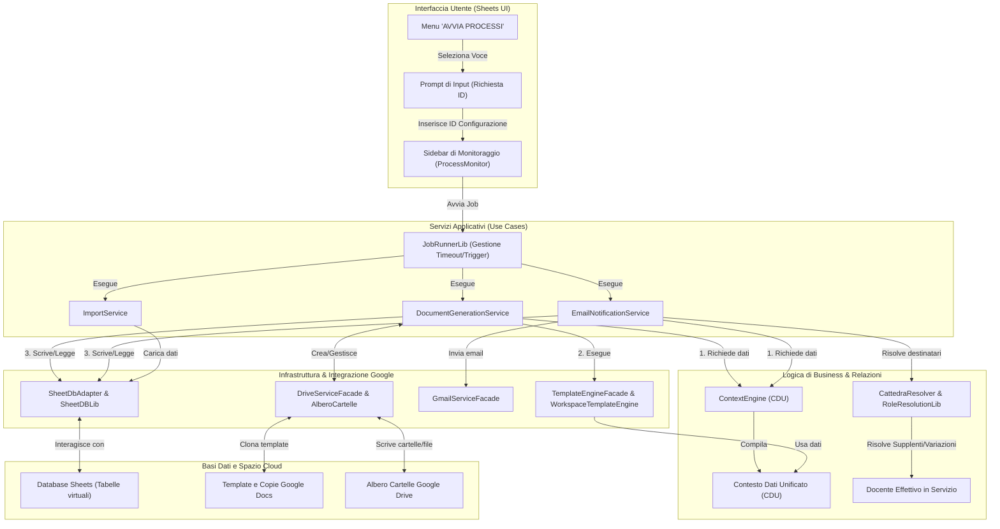
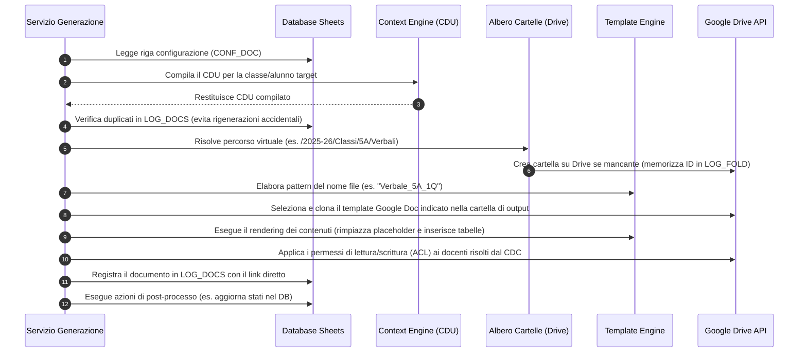
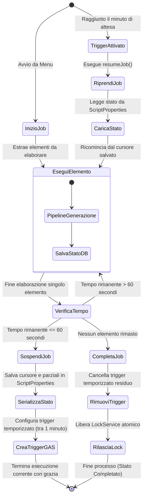

# ALDO (SGSA - Sistema di Gestione Scolastica Automatizzata)

## Manuale Operativo e Architetturale per la Gestione d'Istituto

Benvenuto in **ALDO** (internal codename per **SGSA - Sistema di Gestione Scolastica Automatizzata**), l'ERP scolastico modulare basato su Google Workspace e progettato per digitalizzare e automatizzare i processi amministrativi e didattici di un istituto di istruzione secondaria superiore italiano.

Questo documento ti guiderà alla comprensione del funzionamento di ALDO, spiegando come i dati fluiscono, come vengono generati i documenti formali (verbali, comunicazioni) e come vengono spedite le notifiche email a studenti, docenti e famiglie.

---

## 🏗️ Architettura Generale del Flusso Dati

Il diagramma seguente mostra come un'azione avviata dall'utente sul Foglio Google attraversi tutti i livelli del sistema per interagire con le basi dati Sheets e i servizi cloud di Google Workspace (Drive, Docs, Gmail).



---

## 1. Scopo e Obiettivi Operativi di ALDO

Nella gestione quotidiana di una scuola superiore italiana, la segreteria, la dirigenza e i docenti collaboratori spendono centinaia di ore in adempimenti burocratici ripetitivi. ALDO si propone di automatizzare queste attività critiche:

- **Riconciliazione dei Dati**: Centralizza le anagrafiche provenienti da software diversi (registro elettronico, SIDI, database interni) eliminando le incongruenze.
- **Gestione Dinamica delle Cattedre**: Traccia le assenze dei docenti e le supplenze temporanee in tempo reale. Invia le comunicazioni del Consiglio di Classe (CDC) al docente effettivamente in servizio quel giorno.
- **Generazione Documentale Massiva**: Produce in pochi clic i Verbali dei Consigli di Classe, i Piani Didattici Personalizzati (PDP) per studenti con BES/DSA, e i pagellini delle carenze.
- **Comunicazione Scuola-Famiglia**: Notifica automaticamente le famiglie delle carenze dei propri figli e dei piani didattici concordati, tracciando digitalmente le ricevute di invio.
- **Gestione dei Permessi di Scrittura (ACL)**: Protegge i fogli di calcolo scolastici consentendo a ciascun docente di modificare unicamente le celle o colonne associate alle sue materie di insegnamento nella rispettiva classe, impedendo modifiche non autorizzate ai dati degli altri colleghi.

---

## 2. Interazione con l'Utente (Interfaccia)

L'utente interagisce con ALDO direttamente all'interno del proprio **Foglio Google Principale** (che funge da cruscotto operativo e database) tramite due modalità:

### A. Il Menu Personalizzato "AVVIA PROCESSI"

All'apertura del foglio di calcolo, la funzione globale `onOpen` in [index.ts](file:///home/giulio/Desktop/ALDO%20implementing/src/index.ts) delega a [Menu.ts](file:///home/giulio/Desktop/ALDO%20implementing/src/presentation/Menu.ts) la creazione di una voce di menu dedicata nella barra superiore di Google Sheets.

Il menu si articola in tre azioni principali:

1.  **GENERAZIONE DOCUMENTI**: Avvia la creazione massiva di verbali o pagelle.
2.  **COMUNICAZIONI EMAIL**: Avvia la spedizione massiva di messaggi di notifica.
3.  **IMPORTAZIONI**: Avvia i processi di allineamento ETL dei dati dagli estratti CSV esterni.

> [!NOTE]
> All'avvio di una di queste azioni, ALDO mostra una finestra di dialogo nativa (Prompt) chiedendo l'**ID della configurazione** da eseguire (es. `VERBALE_CDC_1Q` per generare i verbali del primo quadrimestre). Questo approccio rende il sistema interamente **data-driven**: per aggiungere un nuovo tipo di documento o email, non serve scrivere codice, basta configurare una nuova riga nel foglio di calcolo.

### B. La Sidebar di Monitoraggio in Tempo Reale

Subito dopo aver inserito l'ID di configurazione e confermato l'avvio, l'interfaccia utente apre una barra laterale (Sidebar) HTML integrata in Google Sheets. Questa barra (gestita tramite la libreria `GasProcessMonitorLib`) mostra:

- La percentuale complessiva di avanzamento del processo.
- Il nome dell'elemento attualmente in elaborazione (es. _"Classe 5A - Alunno Rossi Mario"_).
- La lista delle fasi eseguite per ciascun elemento con indicatori visivi di successo (verde) o avviso/errore (rosso).
- Eventuali messaggi diagnostici dettagliati per facilitare il debug operativo in caso di dati mancanti.

---

## 3. Modello dei Dati (Database Relazionale su Sheets)

ALDO tratta il Foglio Google come un vero e proprio database relazionale. Le tabelle e i vincoli fisici sono definiti in [schema.ts](file:///home/giulio/Desktop/ALDO%20implementing/src/config/schema.ts) ed elaborati tramite l'ORM-lite `SheetDBLib` (L2), garantendo l'integrità referenziale e transazioni atomiche (ACID) per impedire corruzioni dei dati.

### Tabelle dei Registri (Anagrafiche e Dati di Dominio)

| Tabella Sheets        | Scopo Principale                                                                                     | Colonne Chiave                                                                                                                   |
| :-------------------- | :--------------------------------------------------------------------------------------------------- | :------------------------------------------------------------------------------------------------------------------------------- |
| `ALUNNI`              | Anagrafica studenti, stato BES/DSA, tutor di orientamento e contatti dei genitori.                   | `EMAIL`, `COGNOMENOME`, `CLASSE`, `ATTIVO`, `RAPPR_STUD`, `RAPPR_GEN`                                                            |
| `DOCENTI`             | Registro docenti con indirizzo email istituzionale e dipartimento di afferenza.                      | `EMAIL`, `COGNOME`, `NOME`, `GENERE` (usato per calcolare gli appellativi _Prof._ / _Prof.ssa_), `DIPART`, `ITP`                 |
| `CLASSI`              | Elenco delle classi attive, associazione dell'indirizzo di studio, e docenti nominali per materia.   | `ID` (es. "5A"), `ANNO` (1-5), `INDIRIZZO`, `COORD` (Coordinatore di classe), `RUOLI` (mappa cattedre nominali), `ARTICOLAZIONE` |
| `MATERIE`             | Registro delle discipline d'insegnamento, colori per layout UI e configurazioni d'esame.             | `ID` (es. "MAT"), `NOME` (es. "Matematica"), `SINTESI`, `COLORE_1`, `COLORE_2`, `SIMBOLO`                                        |
| `INDIRIZZI`           | Tipologie di indirizzo presenti nell'istituto (es. Informatica, Liceo Scientifico).                  | `ID` (es. "INF"), `NOME`, `TIPO` (Tecnico, Liceo, Professionale)                                                                 |
| `DIPART`              | Dipartimenti disciplinari e rispettivi docenti coordinatori.                                         | `ID`, `NOME`, `CAPO`, `MATERIE`                                                                                                  |
| `RUOLI`               | Ruoli speciali dell'istituto (es. Animatore Digitale, Funzioni Strumentali).                         | `ID`, `NOME`, `DOCENTE`                                                                                                          |
| `PIANI`               | Piani Didattici Personalizzati (PDP) o Piani Educativi Individualizzati (PEI) degli studenti.        | `STUDENTE` (FK su ALUNNI), `TIPO` (PDP, PEI), `PARAMETRI`                                                                        |
| `CARENZE`             | Registro delle insufficienze e dei debiti formativi rilevati nei vari periodi.                       | `STUDENTE` (FK), `PROGRESSIVO`, `CLASSE`, `DATA`, `NOTIFICATO` (booleano), `ASSENZE`, `NOTE`                                     |
| `PROGETTI`            | Attività extracurricolari, progetti d'istituto e ore relative al PCTO (ex Alternanza Scuola Lavoro). | `CLASSE`, `TIPO`, `NOME`, `REFERENTE`, `ORE`, `ORE_ASL`                                                                          |
| `MOV_ALUNNI`          | Storico dei movimenti degli studenti (ritiri, trasferimenti in corso d'anno, passaggi di classe).    | `STUDENTE` (FK), `TIPO` (ritiro, trasferimento, cambio classe), `DATA`, `DA`, `A`                                                |
| `ASL`                 | Consuntivo delle ore di PCTO cumulate dagli alunni.                                                  | `STUDENTE` (FK), `ANNO`, `ORE`                                                                                                   |
| `SUPPLENZE`           | Registro delle supplenze temporanee per assenza del docente titolare.                                | `TITOLARE` (FK su DOCENTI), `SUPPLENTE` (FK), `DAL`, `AL`, `CLASSI`, `MATERIE`                                                   |
| `VARIAZIONI_CATTEDRA` | Assegnazioni definitive di cattedra variate in corso d'anno (modifiche permanenti del personale).    | `CLASSE_ID`, `MATERIA_ID`, `VECCHIO_TITOLARE`, `NUOVO_TITOLARE`, `DATA_DECORRENZA`                                               |

### Tabelle di Configurazione (Data-Driven Engine)

- `MASTER`: Contiene le variabili globali dell'anno scolastico in corso (es. Anno Scolastico "2025-26", Nome del Dirigente Scolastico, ID della cartella Google Drive principale di quell'anno, Email del supervisore).
- `CONF_DOC`: Configura le regole di generazione dei documenti (es. se creare un Google Doc o un PDF, quale template usare, in quale cartella salvare, a chi dare i permessi di lettura/scrittura su Drive, quali azioni post-processo eseguire).
- `CONF_MAIL`: Configura le regole per i flussi email (es. oggetto della mail, quali box HTML inserire nel corpo, se copiare i supplenti, quali condizioni di filtro applicare, se contrassegnare i record come inviati dopo la notifica).
- `CONF_IMP`: Configura i profili di importazione dati e mappatura dei tracciati CSV esterni.

### Tabelle dei Registri di Log (Audit Trail)

- `LOG_DOCS`: Tiene traccia di ogni singolo documento generato dal sistema, memorizzando lo stato (es. CREATO, CONDIVISO), il percorso virtuale, il link diretto a Google Drive, le classi e gli utenti coinvolti.
- `LOG_FOLD`: Registra le cartelle create su Google Drive da ALDO per evitare duplicazioni e velocizzare le operazioni cloud memorizzando gli ID delle cartelle in cache.
- `LOG_MAIL`: Registra l'esito dell'invio di ogni email (es. INVIATO, FALLITO), la data, i destinatari e l'eventuale errore riscontrato per consentire i tentativi di rinvio (retry).

---

## 4. Gestione e Processamento dei Dati

### A. Allineamento dei Dati Esterni (Importazioni)

Il servizio `ImportService` gestisce l'acquisizione di file CSV estratti da altri sistemi software scolastici (Sidi, Axios, ecc.):

1.  L'utente carica il file CSV nella cartella dedicata e avvia il processo dal foglio inserendo l'ID dell'importazione configurato in `CONF_IMP`.
2.  ALDO estrae i dati e li valida usando regole rigide basate su schemi **Zod** (`GasSchemaValidatorLib`), garantendo che indirizzi email, codici classe e date siano nel formato corretto prima del caricamento.
3.  **Ghost Record Detection (Rilevamento Record Fantasma)**: Prima di salvare i record nel database Sheets, ALDO analizza ogni riga. Se una riga presenta solo l'ID chiave compilato ma tutti i campi di contenuto reale sono vuoti, viene classificata come "Ghost Record" e scartata automaticamente. Questo previene la sovrascrittura accidentale di dati validi con record vuoti prodotti da esportazioni scolastiche incomplete.
4.  I dati validati vengono scritti sul rispettivo foglio Sheets applicando logiche di risoluzione dei conflitti (es. inserimento se nuovo, aggiornamento se modificato di recente).

### B. Risoluzione dei Ruoli e dei Supplenti

Uno dei problemi più complessi di una scuola è inviare le comunicazioni e condividere i verbali con i docenti corretti in presenza di assenze o cambi di cattedra. ALDO risolve questo scenario attraverso il componente [CattedraResolver.ts](file:///home/giulio/Desktop/ALDO%20implementing/src/application/services/CattedraResolver.ts) (integrato con `RoleResolutionLib`), applicando una gerarchia di risoluzione a tre livelli per qualunque data dell'anno scolastico:

```
[ LIVELLO 1: SUPPLENZE ]
Cerca se per la data specificata, la classe e la materia esiste un record attivo in SUPPLENZE.
Se sì: il docente supplente sostituisce il docente designato.
Se il supplente è a sua volta assente, risale la catena fino a trovare il docente effettivo.
      │
      ▼ (Se non trova supplenze attive)
[ LIVELLO 2: VARIAZIONI_CATTEDRA ]
Cerca se c'è un record in VARIAZIONI_CATTEDRA per quella classe e materia con data decorrenza antecedente o uguale alla data dell'operazione.
Se sì: il nuovo docente sostituisce definitivamente il docente nominale.
      │
      ▼ (Se non trova variazioni attive)
[ LIVELLO 3: CLASSI (Fallback nominale) ]
Recupera l'email del docente nominale configurato per quella materia e classe nella tabella CLASSI.
```

Grazie a questa gerarchia, le convocazioni o i verbali del Consiglio di Classe generati durante una supplenza di 15 giorni confluiranno automaticamente nella posta elettronica e nel Drive del supplente, garantendo il pieno rispetto delle normative sulla privacy e la continuità del lavoro scolastico.

---

## 5. La Pipeline di Generazione dei Documenti

La generazione di un documento (es. il verbale del consiglio di classe) segue un processo lineare implementato in [DocumentGenerationService.ts](file:///home/giulio/Desktop/ALDO%20implementing/src/application/services/DocumentGenerationService.ts) attraverso 10 step consecutivi gestiti da `PipelineFramework`:



### Aspetti Chiave della Generazione Documenti

> [!TIP]
> **Reverse-Order Rendering**: Google Docs gestisce il testo tramite indici di caratteri. Quando inserisci del testo o espandi una tabella dinamica dall'alto, gli indici dei caratteri successivi cambiano, corrompendo la posizione dei placeholder sottostanti. ALDO (tramite `WorkspaceTemplateEngine`) risolve questo problema scansionando ed elaborando i placeholder **dall'ultimo al primo** (dalla fine del documento all'inizio). In questo modo, l'espansione di un segnaposto non invalida le posizioni di quelli che lo precedono.

- **Gestione delle Classi Articolate (Classi Composte)**: Nelle scuole secondarie è frequente avere classi articolate (es. studenti di indirizzi diversi uniti per alcune materie comuni, come Italiano, ma divisi in gruppi separati per le materie di indirizzo, come Informatica e Sistemi). ALDO riconosce questa struttura tramite la tabella `CLASSI` e il `ContextBuilder`. Quando genera un documento di classe, aggrega correttamente gli elenchi degli studenti dei diversi gruppi e risolve i rispettivi docenti delle materie separate in un unico CDU coerente.
- **Gestione dei Permessi (ACL)**: La condivisione dei file generati non è globale. In base alle impostazioni di `CONF_DOC.PERMESSI`, ALDO assegna in automatico i diritti di accesso su Google Drive:
  - **Edit (Scrittura)**: Ad esempio al Coordinatore di classe per consentirgli di completare il verbale.
  - **View (Lettura)**: A tutti i docenti del Consiglio di Classe per prenderne visione.
- **Meccanismo di Rollback (Transazionale)**: Se durante la pipeline avviene un errore critico (es. il rendering del documento fallisce per un placeholder malformato), il sistema avvia immediatamente un rollback:
  - Elimina fisicamente il file orfano appena clonato su Google Drive per non lasciare "spazzatura" nello spazio cloud.
  - Annulla tutte le modifiche pendenti sulle tabelle del foglio Google (`db.rollback()`), ripristinando il database all'istante esatto precedente all'inizio della generazione.

---

## 6. La Pipeline di Invio delle Comunicazioni

L'invio di notifiche ed email massive (es. la lettera alle famiglie per le carenze del primo quadrimestre) è orchestrato da [EmailNotificationService.ts](file:///home/giulio/Desktop/ALDO%20implementing/src/application/services/EmailNotificationService.ts) ed eseguito tramite una pipeline strutturata in 8 fasi:

1.  **Costruzione del CDU**: Raccoglie tutti i dati relativi all'alunno o alla classe target dell'invio.
2.  **Valutazione delle Condizioni**: Verifica se la condizione specificata nella tabella `CONF_MAIL` è soddisfatta (es. `focus.alunno.didattica.carenze.hasCarenze == true`). Se la condizione è falsa, l'invio per quel target viene saltato silenziosamente.
3.  **Rendering dei Box HTML (Componibilità)**: Costruisce il corpo dell'email in modo dinamico combinando blocchi HTML riutilizzabili definiti nella colonna `BOX_CFG` (gestiti da `ComposableContentLib`). Un'email può essere composta da un blocco di saluto, un blocco centrale con la tabella delle insufficienze e dei relativi voti, un blocco informativo sulle modalità di recupero e un footer istituzionale.
4.  **Composizione Finale**: Integra i box HTML compilati nel template generale dell'email scolastica (con colori di intestazione personalizzati per l'evento, es. rosso per le carenze, blu per le comunicazioni generali) ed elabora eventuali allegati (es. recupera i PDF dei documenti precedentemente generati e loggati in `LOG_DOCS`).
5.  **Risoluzione dei Destinatari**: Identifica gli indirizzi email reali dei genitori (o dei docenti/coordinatore) associati al target, applicando le supplenze correnti (Level 1) per assicurare che gli insegnanti subentranti ricevano le comunicazioni d'ufficio in copia.
6.  **Invio con Gestione Quota (Gmail Service)**: Spedisce il messaggio tramite le API di Gmail. Per far fronte a picchi di traffico o rallentamenti di rete, il servizio integra un sistema di retry automatico con backoff esponenziale (`GasResilienceLib`), evitando il blocco dello script.
7.  **Scrittura nel Registro di Log**: Registra l'esito della notifica nella tabella `LOG_MAIL` (data di invio, destinatari reali, stato _INVIATO_ o _FALLITO_, ed eventuali codici di errore).
8.  **Aggiornamento del Database (Post-Processo)**: Esegue azioni conclusive sulla base dati. Ad esempio, nel caso della notifica delle carenze scolastiche, aggiorna la tabella `CARENZE` impostando la colonna `NOTIFICATO` a `true` per evitare che la stessa insufficienza venga reinviata al successivo ciclo di invio.

### 🧪 Modalità di Test (Simulazione)

Per ragioni di sicurezza, prima di inviare centinaia di email reali alle famiglie degli studenti o ai docenti, l'amministratore può abilitare la **Test Mode** all'avvio del processo.

- In questa modalità, ALDO esegue l'intera pipeline (compila i dati, valuta le condizioni, compone i testi personalizzati), ma **reindirizza tutti i messaggi all'indirizzo email del supervisore d'istituto** (specificato in `MASTER.SUPERVISORE_EMAIL`), mantenendo nel corpo del testo l'indicazione dei destinatari reali che avrebbero dovuto riceverla.
- Questo permette di verificare l'esattezza dei dati, delle formule di saluto (Prof. / Prof.ssa, Caro genitore di...) e dei formati delle tabelle prima della spedizione ufficiale.

---

## 7. Resilienza ed Esecuzione di Lunghi Processi (Timeout Bypass)

Uno dei limiti storici più significativi di Google Apps Script (GAS) è il vincolo di tempo massimo per singola esecuzione: **6 minuti** per gli account Google standard (Gmail) e **30 minuti** per gli account Google Workspace istituzionali. La generazione dei documenti o l'invio di email per scuole con oltre 1000 studenti supererebbero ampiamente questa soglia, causando l'interruzione improvvisa dello script con conseguente perdita di stato e dati duplicati o incompleti.

ALDO supera brillantemente questo limite integrando la libreria `JobRunnerLib` tramite il **Recursive Trigger Pattern**:



1.  **Iteratori e Generator TypeScript (`yield`)**: I cicli di elaborazione massivi sono implementati come funzioni generatrici (`function*`). Ad ogni iterazione (es. dopo aver generato le pagelle per una classe o inviato la mail a un genitore), lo script esegue un checkpoint (`yield`).
2.  **Monitoraggio Attivo del Tempo**: Ad ogni `yield`, il motore `JobRunnerLib` calcola il tempo trascorso dall'inizio dell'esecuzione. Se il tempo rimanente scende sotto una soglia di sicurezza (solitamente 60 secondi prima del timeout di GAS), il runner avvia la procedura di sospensione.
3.  **Salvataggio dello Stato e Cursore**: Lo stato corrente del processo, inclusi l'indice del record a cui si era rimasti (cursore), i dati temporanei accumulati e i parametri originali del job, viene convertito in formato stringa JSON e salvato in modo permanente nello spazio di archiviazione dello script (`ScriptProperties`).
4.  **Autoprogrammazione del Trigger**: Il runner programma un trigger temporizzato nativo di Apps Script impostato per riattivarsi automaticamente dopo un minuto.
5.  **Terminazione Ordinata**: L'istanza corrente dello script termina l'esecuzione in modo pulito e controllato, salvando le modifiche al foglio di calcolo.
6.  **Ripresa Automatica**: Passato il minuto di pausa, Google avvia la funzione globale `resumeJob` (esposta in [EntryPoints.ts](file:///home/giulio/Desktop/ALDO%20implementing/src/entrypoints/EntryPoints.ts)). Questa funzione recupera lo stato dalle `ScriptProperties`, ripristina la pipeline esattamente dal punto in cui era stata interrotta, e prosegue l'elaborazione.
7.  **Chiusura del Job**: Una volta completati tutti i record, il runner rimuove i trigger temporizzati non più necessari e cancella i dati di stato temporanei, impostando lo stato del monitor su "Completato".
8.  **Atomic Locking (Esclusione Mutua)**: Per evitare che un trigger di ripresa si attivi mentre l'istanza precedente sta ancora completando le sue operazioni (es. a causa di rallentamenti temporanei di Google), `JobRunnerLib` acquisisce un blocco atomico tramite il `LockService` di Google Apps Script all'avvio di ogni ciclo. Se il blocco non è acquisibile, l'istanza concorrente si arresta subito per prevenire sovrapposizioni e conflitti di scrittura.

---

## 8. Guida Rapida di Risoluzione Problemi per l'Amministratore

Ecco come affrontare le problematiche operative più comuni durante l'utilizzo quotidiano di ALDO:

### ⚠️ Errore: "Configurazione non trovata"

- **Causa**: L'ID inserito nel prompt non è presente nella colonna `ID` del rispettivo foglio di configurazione (`CONF_DOC`, `CONF_MAIL` o `CONF_IMP`).
- **Soluzione**: Controlla l'ortografia nel foglio corrispondente. Assicurati che non vi siano spazi vuoti all'inizio o alla fine dell'ID nella cella del foglio.

### ⚠️ Errore: "Quota di invio email superata"

- **Causa**: Google limita il numero di email inviabili giornalmente (in genere 100 per account Gmail gratuiti, 1500-2000 per account istituzionali Google Workspace).
- **Soluzione**: ALDO traccia in `LOG_MAIL` gli invii falliti con lo stato _FALLITO_. Una volta ripristinata la quota giornaliera il giorno successivo, puoi avviare il servizio di recupero (`EmailRetryService`) per scansionare i log e reinviare in blocco unicamente i messaggi non consegnati, senza duplicare gli invii completati con successo.

### ⚠️ Un documento generato contiene placeholder non compilati (es. `{{focus.alunno.note}}`)

- **Causa**: La ricetta dati (`Recipe`) scelta per quella configurazione non includeva il Provider di dati specifico, oppure il campo corrispondente nel database Sheets era vuoto.
- **Soluzione**: Verifica che nella tabella di anagrafica il dato dello studente o del docente sia correttamente compilato. Se il dato esiste ma non viene compilato, la configurazione del documento potrebbe richiedere una ricetta dati più estesa (es. passare da `CLASSE_COMPLETA` a una ricetta focalizzata sull'alunno).

### ⚠️ Il processo si interrompe e la sidebar rimane bloccata su "In elaborazione"

- **Causa**: Si è verificato un errore bloccante insolito (es. crash di un servizio esterno di Google) prima che il JobRunner potesse programmare il trigger di ripresa.
- **Soluzione**: Riapri il menu **AVVIA PROCESSI** e riavvia lo stesso processo inserendo lo stesso ID. Il sistema rileverà i documenti già registrati in `LOG_DOCS` e le email registrate in `LOG_MAIL`, riprendendo automaticamente l'elaborazione dei seuls record rimanenti senza sovrascrivere o rispedire il lavoro già svolto.

---

## 🛠️ Riferimenti Tecnici per Sviluppatori e Manutentori

Se sei un amministratore di sistema o uno sviluppatore incaricato di aggiornare o estendere ALDO, fai riferimento ai seguenti moduli di codice sorgente:

- **Configurazione e Inizializzazione**: Registrazione delle dipendenze e avvio in [Bootstrap.ts](file:///home/giulio/Desktop/ALDO%20implementing/src/config/Bootstrap.ts) ed esposizione dei punti di ingresso nativi in [index.ts](file:///home/giulio/Desktop/ALDO%20implementing/src/index.ts).
- **Modifica del Database**: Per aggiungere colonne o tabelle virtuali, modifica lo schema relazionale in [schema.ts](file:///home/giulio/Desktop/ALDO%20implementing/src/config/schema.ts) e l'adattatore concreto in [SheetDbAdapter.ts](file:///home/giulio/Desktop/ALDO%20implementing/src/infrastructure/db/SheetDbAdapter.ts).
- **Pipeline Documenti**: Le classi e le regole che compongono le 10 fasi di generazione sono in [documentSteps.ts](file:///home/giulio/Desktop/ALDO%20implementing/src/infrastructure/steps/documentSteps.ts). I dettagli sui generatori specifici si trovano in [DocumentGenerationService.ts](file:///home/giulio/Desktop/ALDO%20implementing/src/application/services/DocumentGenerationService.ts).
- **Pipeline Email**: Le classi e i moduli che gestiscono la composizione, la risoluzione dei destinatari e l'invio delle email si trovano in [emailSteps.ts](file:///home/giulio/Desktop/ALDO%20implementing/src/infrastructure/steps/emailSteps.ts) ed in [EmailNotificationService.ts](file:///home/giulio/Desktop/ALDO%20implementing/src/application/services/EmailNotificationService.ts).
- **Architettura Globale**: Una descrizione approfondita di tutti i file di test, di configurazione build e delle cartelle del workspace è disponibile in [ARCH.md](file:///home/giulio/Desktop/ALDO%20implementing/ARCH.md).
