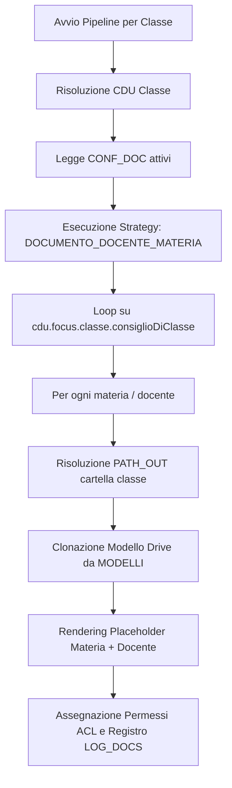

# Guida all'Implementazione del Generatore `DOCUMENTO_DOCENTE_MATERIA`

## 1. Perché creare il Generatore `DOCUMENTO_DOCENTE_MATERIA`

Nelle scuole secondarie, molti documenti amministrativi e didattici non vengono prodotti a livello di intera classe (1 file per classe) né a livello di singolo alunno (1 file per alunno), ma **per ciascuna materia / docente all'interno di una classe** (1 file per materia/docente per ogni classe). 

Esempi classici:
* **Programmi Svolti** a fine anno scolastico
* **Relazioni Finali del Docente**
* **Programmazioni Didattiche Iniziali di Materia**
* **Relazioni Disciplinari**

### Il Principio ALDO: 100% Data-Driven
Creare una classe TypeScript / Strategy distinta per ciascuna di queste tipologie di documento (es. `ProgrammaSvoltoGeneratorStrategy`, `RelazioneFinaleGeneratorStrategy`, `ProgrammazioneGeneratorStrategy`) violerebbe l'architettura data-driven di ALDO/SGSA.

Creando invece un unico generatore generico **`DOCUMENTO_DOCENTE_MATERIA`**:
1. **Scrivi il codice della Strategy una sola volta** in `src/application/strategies/`.
2. **Registri la Strategy una sola volta** in `src/config/Bootstrap.ts`.
3. **Qualsiasi nuovo documento** per materia/docente potrà essere aggiunto in futuro **semplicemente inserendo una riga nella tabella `CONF_DOC` del database**, senza dover modificare o ricompilare il codice dell'applicazione.

---

## 2. Architettura e Funzionamento

### Flusso di Esecuzione
Quando la pipeline di generazione documenti viene eseguita per una classe (o in batch per tutte le classi):



1. **Lettura CDU**: La Strategy accede al CDU della classe (`focus.classe`), in particolare a `focus.classe.consiglioDiClasse`, che contiene l'elenco self-contained di tutti i docenti e delle relative materie insegnate nella classe.
2. **Iterazione Materie/Docenti**: Per ciascuna materia associata a un docente:
   * Sostituisce i placeholder dinamici nel percorso cartella `PATH_OUT` (es. `Programmi Svolti/{{now.annoScolastico}}/{{focus.classe.anagrafica.nome}}`).
   * Ottiene o crea la cartella di classe tramite `AlberoCartelle` (che garantisce che **tutti i file della classe finiscano nella medesima cartella**).
   * Genera il nome univoco del file basandosi sul pattern `FILE_NAME` (es. `Programma_{{focus.classe.anagrafica.nome}}_{{focus.materia.sigla}}_{{focus.docente.anagrafica.cognome}}`).
   * Clona il modello Google Docs specificato in `CONF_DOC.MODELLI` e renderizza i dati del docente e della materia tramite `WorkspaceTemplateEngine`.

---

## 3. Passo 1: Creazione della Strategy TypeScript

Crea il file `src/application/strategies/DocumentoDocenteMateriaGeneratorStrategy.ts`:

```typescript
import type { GeneratorStrategy } from './GeneratorStrategy';
import type { Cdu } from '../context-engine/Cdu';
import type { ConfigurazioneDocumento } from '../../domain/entities/ConfigurazioneDocumento';
import type { ITemplateEngine } from '../../infrastructure/facades/TemplateEngineFacade';
import type { IDriveFacade } from '../../infrastructure/facades/DriveServiceFacade';
import { ConfigurationError } from '../../domain/errors/DomainError';

/**
 * Strategy per la generazione di un documento distinto per ogni materia / docente
 * presente nel Consiglio di Classe (es. Programmi Svolti, Relazioni Finali).
 */
export class DocumentoDocenteMateriaGeneratorStrategy implements GeneratorStrategy {
  constructor(
    private readonly templates: ITemplateEngine,
    private readonly drive: IDriveFacade
  ) {}

  render(fileId: string, cdu: Cdu, config: ConfigurazioneDocumento): void {
    const classe = cdu.focus.classe;
    if (!classe) {
      throw new ConfigurationError(
        `CONF_DOC ${config.id ?? '?'}: DOCUMENTO_DOCENTE_MATERIA richiede focus.classe nel CDU`
      );
    }

    const cdc = classe.consiglioDiClasse ?? [];
    for (const docenteCdc of cdc) {
      for (const materia of docenteCdc.materie) {
        // Contesto arricchito per la singola materia / docente
        const materiaContext: Record<string, unknown> = {
          ...(cdu as unknown as Record<string, unknown>),
          focus: {
            ...cdu.focus,
            docente: docenteCdc.anagrafica,
            materia: materia
          }
        };

        // Processa il documento aperto per la materia specifica
        this.templates.processDocument(fileId, materiaContext);
      }
    }
  }
}
```

---

## 4. Passo 2: Registrazione nel Service Container

In `src/config/Bootstrap.ts`, inserisci la nuova Strategy nella mappa `strategyRegistry`:

```typescript
import { DocumentoDocenteMateriaGeneratorStrategy } from '../application/strategies/DocumentoDocenteMateriaGeneratorStrategy';

// All'interno di Bootstrap.ts:
c.register('strategyRegistry', (container) => {
  const registry = new Map<string, GeneratorStrategy>([
    ['VERBALE_CDC', new VerbaleGeneratorStrategy(deps.templates)],
    ['DOCUMENTO_GENERICO', new DocumentoGenericoGeneratorStrategy(deps.templates)],
    ['DOC_PERSONALIZZATO', new DocPersonalizzatoGeneratorStrategy(deps.templates)],
    ['DOCUMENTO_DOCENTE_MATERIA', new DocumentoDocenteMateriaGeneratorStrategy(deps.templates, deps.drive)]
  ]);
  // ...
  return registry;
});
```

---

## 5. Passo 3: Configurazione nel Database (`CONF_DOC`)

Una volta registrata la Strategy `DOCUMENTO_DOCENTE_MATERIA`, puoi definire **qualsiasi tipo di documento per materia/classe** aggiungendo semplicemente delle righe alla tabella `CONF_DOC` del database Google Sheets.

### Esempio 1: Programmi Svolti
* **`ID`**: `PROGRAMMA_SVOLTO`
* **`TIPO`**: `PROGRAMMA_SVOLTO`
* **`NOME`**: `Programma Svolto Annuale`
* **`GENERATORE`**: `DOCUMENTO_DOCENTE_MATERIA`
* **`FORMATO`**: `GDOC`
* **`DUPLICAZIONE`**: `PERMESSA`
* **`GESTIONE_ARTICOLAZIONE`**: `COMPLETA`
* **`PATH_OUT`**: `Programmi Svolti/{{now.annoScolastico}}/{{focus.classe.anagrafica.nome}}`
* **`FILE_NAME`**: `ProgrammaSvolto_{{focus.classe.anagrafica.nome}}_{{focus.materia.sigla}}_{{focus.docente.anagrafica.cognome}}`
* **`MODELLI`**: `{"templateId":"1TEMPLATE_PROGRAMMA_SVOLTO_ID"}`
* **`PERMESSI`**: `{"file":[{"ruolo":"DOCENTE","permesso":"SCRITTURA"}],"folder":[{"ruolo":"CDC","permesso":"LETTURA"}]}`

### Esempio 2: Relazioni Finali del Docente
* **`ID`**: `RELAZIONE_FINALE_DOCENTE`
* **`TIPO`**: `RELAZIONE_FINALE`
* **`NOME`**: `Relazione Finale del Docente`
* **`GENERATORE`**: `DOCUMENTO_DOCENTE_MATERIA`
* **`FORMATO`**: `GDOC`
* **`DUPLICAZIONE`**: `PERMESSA`
* **`GESTIONE_ARTICOLAZIONE`**: `COMPLETA`
* **`PATH_OUT`**: `Relazioni Finali/{{now.annoScolastico}}/{{focus.classe.anagrafica.nome}}`
* **`FILE_NAME`**: `RelazioneFinale_{{focus.classe.anagrafica.nome}}_{{focus.materia.sigla}}_{{focus.docente.anagrafica.cognome}}`
* **`MODELLI`**: `{"templateId":"1TEMPLATE_RELAZIONE_FINALE_ID"}`
* **`PERMESSI`**: `{"file":[{"ruolo":"DOCENTE","permesso":"SCRITTURA"}],"folder":[{"ruolo":"COORDINATORI","permesso":"LETTURA"}]}`

### Esempio 3: Programmazioni Didattiche Iniziali
* **`ID`**: `PROGRAMMAZIONE_DOCENTE`
* **`TIPO`**: `PROGRAMMAZIONE`
* **`NOME`**: `Programmazione Didattica di Materia`
* **`GENERATORE`**: `DOCUMENTO_DOCENTE_MATERIA`
* **`FORMATO`**: `GDOC`
* **`DUPLICAZIONE`**: `PERMESSA`
* **`GESTIONE_ARTICOLAZIONE`**: `COMPLETA`
* **`PATH_OUT`**: `Programmazioni/{{now.annoScolastico}}/{{focus.classe.anagrafica.nome}}`
* **`FILE_NAME`**: `Programmazione_{{focus.classe.anagrafica.nome}}_{{focus.materia.sigla}}_{{focus.docente.anagrafica.cognome}}`
* **`MODELLI`**: `{"templateId":"1TEMPLATE_PROGRAMMAZIONE_ID"}`
* **`PERMESSI`**: `{"file":[{"ruolo":"DOCENTE","permesso":"SCRITTURA"}],"folder":[{"ruolo":"CAPO_DIPARTIMENTO","permesso":"LETTURA"}]}`

---

## 6. Verifiche e Test

1. **Verifica Tipo TypeScript**: Esegui `npm run typecheck` per verificare la correttezza delle interfacce.
2. **Linting**: Esegui `npm run lint` per verificare che non vi siano violazioni di regole globali.
3. **Unit Test**: Aggiungi uno unit test in `test/unit/application/generator-strategies.test.ts` per verificare la corretta esecuzione della Strategy `DOCUMENTO_DOCENTE_MATERIA`.
