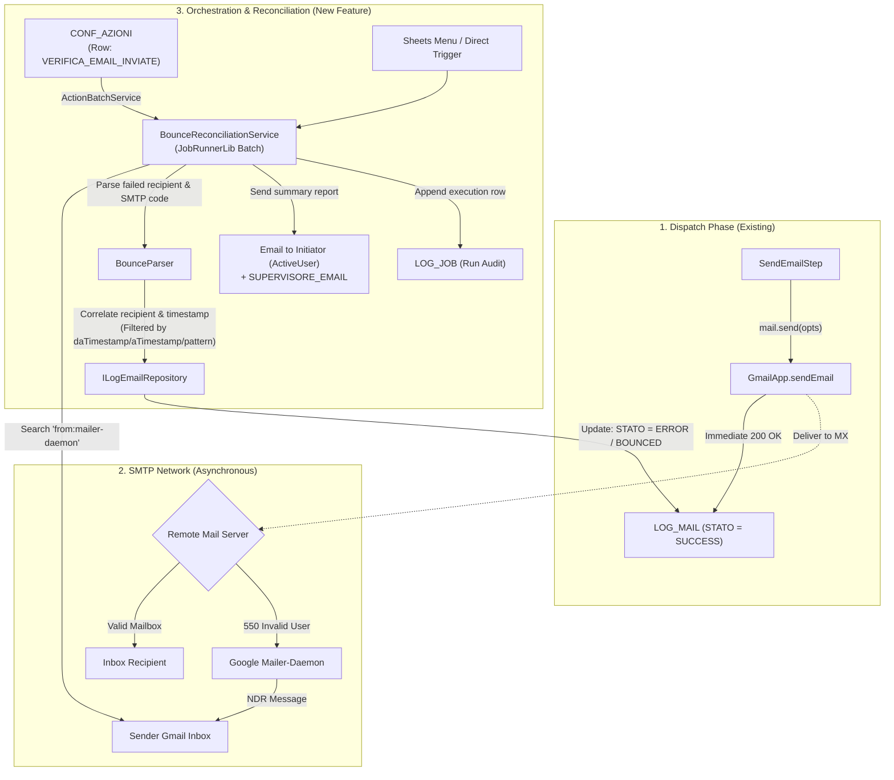

# Specification: Asynchronous Email Bounce Reconciliation & `CONF_MAIL.NOREPLY` Documentation

**Date:** 2026-10-05  
**Status:** DRAFT  
**Scope:** ALDO Application Core (`src/`), GasLibraryFactory (`GoogleApiWrapper`), and Database Specifications (`SPECS_ALDO/`)

---

## 1. Executive Summary & Problem Statement

### 1.1 Context
In ALDO, email notifications are orchestrated in a 9-step pipeline (`NotificaPipeline` in `EmailNotificationService`) and transmitted via `GmailServiceFacade` -> `MailService.send()` (`GoogleApiWrapper`).
When sending emails through Google Apps Script (`GmailApp.sendEmail`):
1. **Synchronous dispatch:** The Google API validates recipient address syntax and immediately accepts the message into Google's outgoing routing queue, returning `success: true`.
2. **Asynchronous bounce:** If a recipient email address is syntactically valid but non-existent on the target mail server (e.g., `nonexistent.user.12345@domain.com`), the remote mail transfer agent (MTA) responds with an SMTP rejection code (e.g., `550 5.1.1 User unknown`). Google then generates an asynchronous Non-Delivery Report (NDR) from `mailer-daemon@googlemail.com` and delivers it to the sender's Gmail inbox minutes or hours later.

### 1.2 Current Gaps
1. **Misleading `LOG_MAIL` status:** At time of send, `LOG_MAIL` records `STATO = SUCCESS`. ALDO currently possesses no automated reconciliation mechanism to scan the sender inbox for NDRs and mark those deliveries as failed retroactively.
2. **The `NOREPLY` trap:** When `CONF_MAIL.NOREPLY = TRUE`, ALDO passes `{ noReply: true }` to `GmailApp.sendEmail()`. Under RFC 3834 / RFC 5321 standards and Google Workspace infrastructure, no-reply return-paths suppress bounce reports to prevent automated mail loops. When `NOREPLY` is enabled, **NDRs are never generated or delivered**, rendering any post-send bounce detection structurally impossible.
3. **Documentation omission:** `SPECS_ALDO/01_SCHEMA_DATABASE.md` currently documents `NOREPLY` simply as *"Aggiunge disclaimer no-reply nel footer"*, failing to warn administrators that enabling `NOREPLY` disables all NDRs and delivery tracking for non-existent addresses.

---

## 2. Requirements

### 2.1 Documentation Update (`SPECS_ALDO/`)
- **Target File:** `SPECS_ALDO/01_SCHEMA_DATABASE.md` (and any related doc references in `SPECS_ALDO/00_PANORAMICA.md`).
- **Section `CONF_MAIL`:**
  - Update description of column `NOREPLY`:
    > **Crucial Behavioral Warning:** If `NOREPLY = TRUE`, Google Workspace dispatches emails with an automated no-reply envelope Return-Path. Under RFC standards, MTA delivery failures (bounces / NDRs) are suppressed or discarded. **It is structurally impossible to detect or reconcile non-delivery of non-existent addresses when `NOREPLY = TRUE`**. If auditability of delivery failures is required for a pattern, `NOREPLY` must remain `FALSE` or blank.
- **Section `LOG_MAIL`:**
  - Update documentation of column `STATO`:
    - Clarify that `STATO = SUCCESS` initially reflects successful ingestion by Google's outbound mail servers.
    - Document the new or updated status transition (`BOUNCED` or `ERROR` with bounce diagnostic) resulting from the Bounce Reconciliation Job.
- **Section `CONF_AZIONI`:**
  - Add `VERIFICA_EMAIL_INVIATE` to the standalone action types catalog.
  - Document that it orchestrates the verification and reconciliation of sent emails against Gmail bounce reports, accepting optional date ranges (`daTimestamp`, `aTimestamp` in `"GG-MM-AAAA HH:MM:SS"` format), relative lookback windows, and pattern filters.

---

### 2.2 GasLibraryFactory Extension Seam (`GoogleApiWrapper`)
*Per architectural rules, ALDO must never call native GAS `GmailApp` directly in application code.*
`GoogleApiWrapper/src/services/MailService.js` must be evaluated and extended:
- **New Method in `MailService`:**
  ```javascript
  /**
   * Searches user messages matching a Gmail search query.
   * @param {string} query Gmail search syntax (e.g. 'from:mailer-daemon newer_than:2d')
   * @param {number} [maxResults=50] Maximum number of messages to retrieve.
   * @returns {Array<{id: string, threadId: string, subject: string, from: string, date: Date, plainBody: string, rawContent?: string}>}
   */
  searchMessages(query, maxResults)
  ```
- **New Method in `IGmailFacade` / `GmailServiceFacade` (ALDO Infrastructure):**
  - Expose `searchBounces(lookbackDays: number): BounceReport[]` delegating cleanly to `MailService`.

---

### 2.3 Email Bounce Reconciliation Job (`BounceReconciliationService`)

#### A. Responsibilities
1. **Inbox Polling:** Query the executing account's Gmail inbox for messages from `mailer-daemon@googlemail.com` within a configurable lookback window (default: last 2 days).
2. **NDR Message Parsing:** Parse the bounce message to extract:
   - Target failed recipient email address (`failedRecipient`).
   - Original dispatch date / message timestamp.
   - Diagnostic code / SMTP failure reason (e.g., `550 5.1.1 User unknown`, `DNS lookup failed`, `Mailbox full`).
   - Original subject line (if present).
3. **`LOG_MAIL` Correlation:**
   - Query `LOG_MAIL` repository for records matching:
     - `DESTINATARI` contains `failedRecipient`.
     - `STATO = 'SUCCESS'`.
     - `DATA` timestamp aligns with original send window.
4. **Audit State Update:**
   - Transition record `STATO` from `SUCCESS` to `ERROR` (or `BOUNCED` if added to `StatoEmail` enum).
   - Append to `ERRORE`: `"Bounce: <SMTP diagnostic or reason extracted from NDR>"`.
   - Update `ALLEGATI` JSON payload with bounce metadata: `{"bouncedAt": "<ISO>", "bounceType": "PERMANENT_550"}`.
5. **Dual Notification & Escalation (Initiator + Supervisor):**
   - Unlike transient delivery network errors, a 550 ("Address not found") bounce represents an invalid database record in `ALUNNI` / `DOCENTI`.
   - The reconciliation service must compile an actionable summary of all reconciled bounces and delivery failures.
   - **Recipients of the summary report:**
     1. **Initiating User:** The user account that triggered the email verification service (retrieved via `activeUser.getEmail()` from `IActiveUserFacade`).
     2. **Supervisor:** `MASTER.SUPERVISORE_EMAIL` (when configured / present in the current school year's configuration).
   - If `SUPERVISORE_EMAIL` is empty or absent, the notification is delivered solely to the initiating user with an informational log.
   - If the initiator and supervisor addresses are identical, the recipient list is deduplicated to avoid sending redundant emails.
   - Notification content includes: total inspected NDRs, count of correlated bounces, list of affected student/teacher names, class references, rejected email addresses, and specific failure diagnostics to facilitate immediate database correction.

#### B. Batch Orchestration via `JobRunnerLib`
- **Job Identifier:** `RECONCILE_BOUNCES`
- **Execution Mode:**
  - Can be triggered manually via Sheets menu: `Comunicazioni` -> `Riconcilia Rimbalzi Email`.
  - Can be executed via timed trigger / scheduler (e.g. daily early morning run).
- **Audit Logging in `LOG_JOB`:**
  - `TIPO = 'RECONCILE_BOUNCES'`
  - `TOTALE_TASK`: count of inspected NDR messages.
  - `COMPLETATI_OK`: count of successfully parsed and correlated bounces.
  - `FALLITI`: unparseable NDRs or correlation anomalies.

---

### 2.4 Standalone Action Configuration (`CONF_AZIONI`)

To adhere to ALDO's data-driven paradigm, email delivery verification must be orchestrable via a dedicated record in the `CONF_AZIONI` table, rather than existing solely as a hardcoded menu entry.

#### A. Physical `CONF_AZIONI` Record Definition
| Column | Value | Notes |
| :--- | :--- | :--- |
| `ID` | `VERIFICA_EMAIL_INVIATE` | Unique identifier in `CONF_AZIONI` |
| `TIPO` | `VERIFICA_EMAIL` | Descriptive category label written to `LOG_JOB.NOME_CONFIG` |
| `ASSE` | `SINGOLA` | Single execution iteration using base school CDU |
| `CONDIZIONE` | *(null or empty)* | Unconditional gate; always executes when triggered |
| `ATTIVO` | `TRUE` | Visible in actions menu / runnable lists |
| `AZIONI` | `[{"tipo":"VERIFICA_EMAIL_INVIATE", ...}]` | JSON action definition carrying filtering parameters |
| `PERIODICITA` | `DAILY` | Reserved for future trigger automation (ignored in v1) |

#### B. JSON Action Schema (`AZIONI` Array)
```json
[
  {
    "tipo": "VERIFICA_EMAIL_INVIATE",
    "daTimestamp": "01-10-2026 00:00:00",
    "aTimestamp": "05-10-2026 23:59:59",
    "lookbackGiorni": 2,
    "pattern": "NOTIFICA_PDP",
    "criteri": {
      "STATO": "SUCCESS"
    }
  }
]
```

#### C. Timestamp Formatting & Filtering Rules
1. **Timestamp Bounds (`daTimestamp` / `aTimestamp`):**
   - **Format:** Strict European date/time format `"GG-MM-AAAA HH:MM:SS"` (e.g., `"01-10-2026 08:30:00"`).
   - **Parsing:** Parsed into JavaScript `Date` instances via `CoreUtilsLib.DateUtils.parseDateWithFormat(val, 'dd-MM-yyyy HH:mm:ss')` (or strict regex `^(\d{2})-(\d{2})-(\d{4})\s+(\d{2}):(\d{2}):(\d{2})$`).
   - If `daTimestamp` is defined, only `LOG_MAIL` records with `DATA >= daTimestamp` are considered.
   - If `aTimestamp` is defined, only `LOG_MAIL` records with `DATA <= aTimestamp` are considered.
2. **Relative Lookback Fallback (`lookbackGiorni` / `lookbackOre`):**
   - If explicit timestamps are omitted, the action dynamically evaluates `daTimestamp = now - lookbackGiorni` (defaulting to 2 days).
3. **Pattern Filtering (`pattern`):**
   - Optional string or string array matching `CONF_MAIL.ID` (e.g. `"NOTIFICA_FAMIGLIE"`). When provided, only `LOG_MAIL` entries created with that specific pattern are subject to bounce correlation.
4. **Execution via `ActionBatchService`:**
   - Handled by a new infra action handler in `src/application/pipelines/azioniInfra.ts` registered under `'VERIFICA_EMAIL_INVIATE'`.
   - The handler invokes `BounceReconciliationService.reconcile(filters)` with the extracted date ranges and pattern criteria.
   - Dispatches the summary report to both the initiating user (`activeUser.getEmail()`) and `SUPERVISORE_EMAIL` (when present), deduplicated.
   - Returns the count of reconciled/updated records.

---

## 3. Detailed Component Architecture



---

## 4. Work Breakdown & Implementation Plan

### Task 1: Update Database Specifications (`SPECS_ALDO/01_SCHEMA_DATABASE.md`)
- Update `CONF_MAIL` table definition to clearly explain the `NOREPLY` trade-off:
  - Document that `NOREPLY = TRUE` switches Return-Path to no-reply, causing MTAs to suppress NDRs and rendering asynchronous bounce detection impossible.
- Update `LOG_MAIL` table definition:
  - Add `BOUNCED` as a recognized value for `STATO` (or document transition to `ERROR` with NDR details).
- Update `CONF_AZIONI` catalog table:
  - Document `VERIFICA_EMAIL_INVIATE` action type and its JSON schema with timestamp ranges (`"GG-MM-AAAA HH:MM:SS"`) and pattern filters.

### Task 2: Extend `GasLibraryFactory` (`GoogleApiWrapper`)
- Extend `MailService` with `searchMessages(query, maxResults)`.
- Write unit tests in `GasLibraryFactory/GoogleApiWrapper` for search parsing and error handling.
- Run `npm run build` in `GasLibraryFactory` and `npm run refresh:vendor` in ALDO workspace.

### Task 3: ALDO Infrastructure - `IGmailFacade` & `GmailServiceFacade`
- Update `IGmailFacade` interface:
  ```typescript
  export interface BounceMessage {
    id: string;
    date: Date;
    subject: string;
    body: string;
  }

  export interface IGmailFacade {
    sendEmail(opts: EmailSendOptions): EmailSendResult;
    getRemainingQuota(): number;
    searchBounceMessages(lookbackDays: number): BounceMessage[];
  }
  ```
- Implement `searchBounceMessages` in `GmailServiceFacade` calling `MailService.searchMessages`.
- Update mock `FakeGmailFacade` in `test/fakes/FakeGmailFacade.ts`.

### Task 4: NDR Parser (`src/application/email/NdrParser.ts`)
- Implement a dedicated parser utility to extract:
  - Bounced recipient address (handles both standard Google NDR formats and RFC 3464 format).
  - Diagnostic status code (`550`, `551`, `552`, `554`, etc.).
  - Reason description.
- Comprehensive unit tests covering various mail provider NDR formats (Google, Microsoft 365, generic postfix).

### Task 5: Application Service `BounceReconciliationService`
- Implement `BounceReconciliationService` with dependencies:
  - `gmail: IGmailFacade`
  - `logMail: ILogEmailRepository`
  - `logJob: ILogJobRepository`
  - `master: IMasterSheetRepository`
  - `activeUser: IActiveUserFacade`
  - `logger: LoggerService`
- Generator-based batch handler for `JobRunnerLib` (`reconcileBouncesHandler`).
- Correlate parsed bounces with `LOG_MAIL` entries according to timestamp and pattern filters.
- Send summary notification report to both the initiating user (`activeUser.getEmail()`) and `SUPERVISORE_EMAIL` (when present), deduplicating recipient addresses.

### Task 6: Standalone Action Handler Integration (`CONF_AZIONI`)
- Extend `Azione` interface in `src/application/pipelines/standaloneActions.ts`:
  ```typescript
  export interface Azione {
    tipo: string;
    // ... existing fields ...
    daTimestamp?: string;
    aTimestamp?: string;
    lookbackGiorni?: number;
    pattern?: string | string[];
  }
  ```
- Register `VERIFICA_EMAIL_INVIATE` handler in `src/application/pipelines/azioniInfra.ts` (`creaHandlersInfra`).
- Parse `"GG-MM-AAAA HH:MM:SS"` dates using `CoreUtilsLib.DateUtils.parseDateWithFormat`.
- Delegate execution to `BounceReconciliationService`.

### Task 7: Presentation, Seeders & Wiring
- Wire service into `src/config/Bootstrap.ts` and `ServiceContainer.ts`.
- Register job in `JobDefinitionRegistry`.
- Add default `CONF_AZIONI` row (`VERIFICA_EMAIL_INVIATE`) in sample database builders (`SharedTestDatabaseBuilder.ts`, `SampleDatabaseBuilder.ts`).
- Add menu action in `src/presentation/Menu.ts` under "Comunicazioni / Azioni".

---

## 5. Non-Functional & Boundary Conditions

1. **Idempotency:** A single NDR must not alter `LOG_MAIL` multiple times or trigger repeated supervisor alerts. Reconciled records in `LOG_MAIL` must track the NDR message ID.
2. **Safety & Privacy:** Bounce messages contain student/parent email addresses. All logging must apply `PiiRedactor` to protect personal identifiable data.
3. **Graceful Handling of `NOREPLY` Patterns:** If a user runs bounce reconciliation for a pattern configured with `NOREPLY = TRUE`, the system must not error out, but informational logs must explain why no bounces were found.
4. **GAS Execution Constraints:** Searching and parsing Gmail messages consumes time. The service must respect time budgets and yield checkpoints through `JobRunnerLib`.
